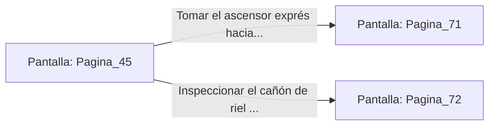

# 📺 Nodo Pantalla: `Pagina_45`

[[Index|⬅️ Índice]] | Fichero Origen: [[sample_eligejuego-code_capitulo_03_mpl|📄 sample/eligejuego-code/capitulo_03.mpl]]

**Narrativa y Encabezado:**
> PÁGINA 45: LA HUIDA DE LA GALERÍA
> 
> Corres a través del portón despejado justo cuando las sirenas de alarma comienzan a aullar en los niveles superiores. Tras de ti, las pesadas compuertas de seguridad se cierran de golpe, bloqueando el paso a la guardia que acudía al aviso.
> 
> Te encuentras en una gran galería acristalada que conecta la zona industrial con los Bastiones de Guerra. El paisaje exterior muestra una tormenta de éter azotando las agujas de Aethelgard.
> 
> Ante ti hay un puesto de control abandonado con un cañón de riel fijo y un ascensor exprés que desciende a los niveles profundos.

## 📋 Desglose de Instrucciones de Opciones
### `OPCION "Tomar el ascensor exprés hacia los niveles profundos" CON_ACCION TRANSICIONAR_A Pagina_71`
* **Instrucción:** `OPCION` *(Manual: Mapea una entrada o botón interactivo de usuario. Vincular una acción como la invocación de una función C1, un método C2 o una transición C3.)*
* **Efecto de Control:** Dispara `TRANSICIONAR_A` hacia [[Pantalla_Pagina_71|📺 Pagina_71]]
### `OPCION "Inspeccionar el cañón de riel del puesto de control" CON_ACCION TRANSICIONAR_A Pagina_72`
* **Instrucción:** `OPCION` *(Manual: Mapea una entrada o botón interactivo de usuario. Vincular una acción como la invocación de una función C1, un método C2 o una transición C3.)*
* **Efecto de Control:** Dispara `TRANSICIONAR_A` hacia [[Pantalla_Pagina_72|📺 Pagina_72]]

## 📊 Diagrama de Flujo e Interacción (Mermaid)

