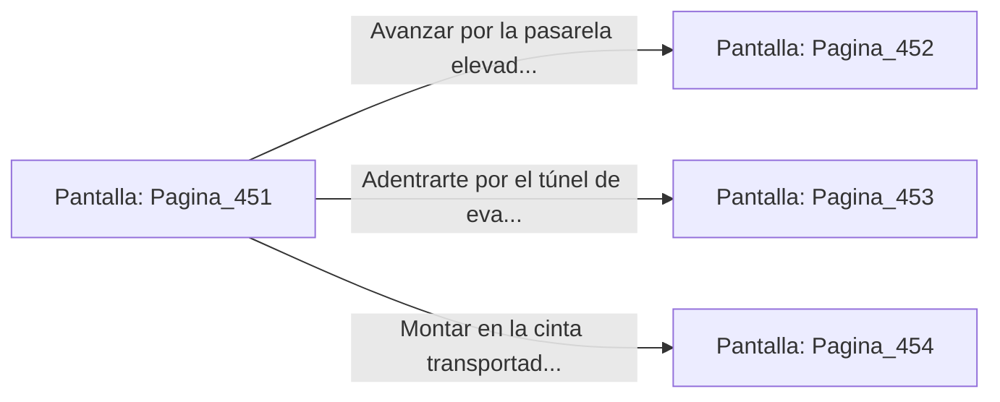

# 📺 Nodo Pantalla: `Pagina_451`

[[Index|⬅️ Índice]] | Fichero Origen: [[sample_eligejuego-code_capitulo_24_mpl|📄 sample/eligejuego-code/capitulo_24.mpl]]

**Narrativa y Encabezado:**
> PÁGINA 451: LOS TALLERES DE FORJA DE TITANIO
> 
> Atraviesas el portón acorazado e ingresas en la inmensa nave de los Talleres de Forja de Titanio. Inmensos martillos hidráulicos, crisoles de fundición que borbotean con metal incandescente y brazos mecánicos suspendidos del techo dominan el paisaje bajo una atmósfera sofocante que huele a azufre y metal candente.
> 
> Tu Brazal de Convergencia indica que las Cámaras 451 a 470 constituyen el complejo industrial donde se ensamblaban los blindajes pesados para las defensas de Aethelgard. Autómatas Fundidores de titanio con brazos articulados y sierras térmicas patrullan las pasarelas de rejilla.
> 
> Frente a ti se abren tres itinerarios para atravesar la fábrica: una pasarela elevada suspendida sobre los crisoles, un túnel de evacuación de escoria y una cinta transportadora de lingotes pesados.

## 📋 Desglose de Instrucciones de Opciones
### `OPCION "Avanzar por la pasarela elevada sobre los crisoles de fundición" CON_ACCION TRANSICIONAR_A Pagina_452`
* **Instrucción:** `OPCION` *(Manual: Mapea una entrada o botón interactivo de usuario. Vincular una acción como la invocación de una función C1, un método C2 o una transición C3.)*
* **Efecto de Control:** Dispara `TRANSICIONAR_A` hacia [[Pantalla_Pagina_452|📺 Pagina_452]]
### `OPCION "Adentrarte por el túnel de evacuación de escoria" CON_ACCION TRANSICIONAR_A Pagina_453`
* **Instrucción:** `OPCION` *(Manual: Mapea una entrada o botón interactivo de usuario. Vincular una acción como la invocación de una función C1, un método C2 o una transición C3.)*
* **Efecto de Control:** Dispara `TRANSICIONAR_A` hacia [[Pantalla_Pagina_453|📺 Pagina_453]]
### `OPCION "Montar en la cinta transportadora de lingotes pesados" CON_ACCION TRANSICIONAR_A Pagina_454`
* **Instrucción:** `OPCION` *(Manual: Mapea una entrada o botón interactivo de usuario. Vincular una acción como la invocación de una función C1, un método C2 o una transición C3.)*
* **Efecto de Control:** Dispara `TRANSICIONAR_A` hacia [[Pantalla_Pagina_454|📺 Pagina_454]]

## 📊 Diagrama de Flujo e Interacción (Mermaid)

