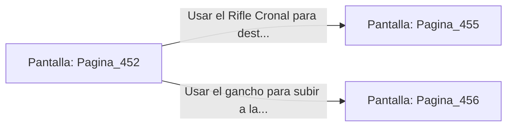

# 📺 Nodo Pantalla: `Pagina_452`

[[Index|⬅️ Índice]] | Fichero Origen: [[sample_eligejuego-code_capitulo_24_mpl|📄 sample/eligejuego-code/capitulo_24.mpl]]

**Narrativa y Encabezado:**
> PÁGINA 452: LA PASARELA DE LOS CRISOLES
> 
> Avanzas a paso firme por la pasarela metálica mientras el calor radiante de los crisoles hace chisporrotear el aire a tu alrededor. El brillo anaranjado del titanio fundido ilumina las vigas del techo con un tono tenebroso.
> 
> A mitad de la travesía, un Autómata Fundidor bloquea la vía esgrimiendo una sierra térmica encendida que emite un chasquido estridente.

## 📋 Desglose de Instrucciones de Opciones
### `OPCION "Usar el Rifle Cronal para destruir la articulación del autómata" CON_ACCION TRANSICIONAR_A Pagina_455`
* **Instrucción:** `OPCION` *(Manual: Mapea una entrada o botón interactivo de usuario. Vincular una acción como la invocación de una función C1, un método C2 o una transición C3.)*
* **Efecto de Control:** Dispara `TRANSICIONAR_A` hacia [[Pantalla_Pagina_455|📺 Pagina_455]]
### `OPCION "Usar el gancho para subir a la viga de soporte superior" CON_ACCION TRANSICIONAR_A Pagina_456`
* **Instrucción:** `OPCION` *(Manual: Mapea una entrada o botón interactivo de usuario. Vincular una acción como la invocación de una función C1, un método C2 o una transición C3.)*
* **Efecto de Control:** Dispara `TRANSICIONAR_A` hacia [[Pantalla_Pagina_456|📺 Pagina_456]]

## 📊 Diagrama de Flujo e Interacción (Mermaid)

