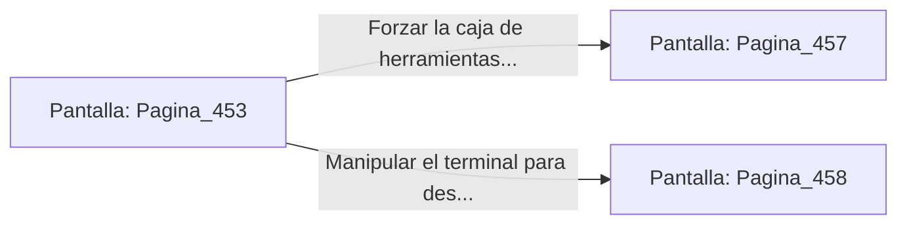

# 📺 Nodo Pantalla: `Pagina_453`

[[Index|⬅️ Índice]] | Fichero Origen: [[sample_eligejuego-code_capitulo_24_mpl|📄 sample/eligejuego-code/capitulo_24.mpl]]

**Narrativa y Encabezado:**
> PÁGINA 453: EL TÚNEL DE EVACUACIÓN DE ESCORIA
> 
> Te introduces en el angosto túnel de piedra refractaria por el que discurre una canaleta con residuos metálicos al rojo vivo. El calor dentro del conducto es abrasador y exige que los sistemas de refrigeración de tu armadura funcionen al límite de su capacidad.
> 
> Tras superar el tramo más angosto, alcanzas un nicho de mantenimiento donde reposa una caja de herramientas blindada y un terminal de diagnóstico activo.
> 
> Tienes la opción de forzar la caja para recuperar células de energía o manipular el terminal para desviar la escoria lejos de la vía.

## 📋 Desglose de Instrucciones de Opciones
### `OPCION "Forzar la caja de herramientas blindada" CON_ACCION TRANSICIONAR_A Pagina_457`
* **Instrucción:** `OPCION` *(Manual: Mapea una entrada o botón interactivo de usuario. Vincular una acción como la invocación de una función C1, un método C2 o una transición C3.)*
* **Efecto de Control:** Dispara `TRANSICIONAR_A` hacia [[Pantalla_Pagina_457|📺 Pagina_457]]
### `OPCION "Manipular el terminal para desviar la canaleta de escoria" CON_ACCION TRANSICIONAR_A Pagina_458`
* **Instrucción:** `OPCION` *(Manual: Mapea una entrada o botón interactivo de usuario. Vincular una acción como la invocación de una función C1, un método C2 o una transición C3.)*
* **Efecto de Control:** Dispara `TRANSICIONAR_A` hacia [[Pantalla_Pagina_458|📺 Pagina_458]]

## 📊 Diagrama de Flujo e Interacción (Mermaid)

