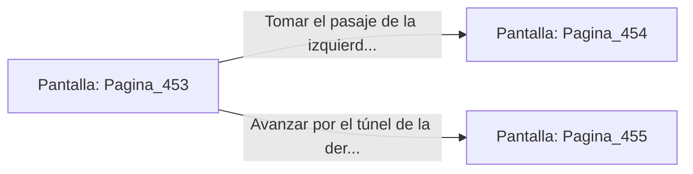

# 📺 Nodo Pantalla: `Pagina_453`

[[Index|⬅️ Índice]] | Fichero Origen: [[sample_eligejuego-code_capitulo_08_galeria_espejos_mpl|📄 sample/eligejuego-code/capitulo_08_galeria_espejos.mpl]]

**Narrativa y Encabezado:**
> Página 453: La Galería de los Espejos
> 
> Espejos de bordes afilados reflejan formas distorsionadas que no corresponden a tus movimientos. Te encuentras ante una encrucijada en la penumbra de la mazmorra. Debes tomar una decisión.

## 📋 Desglose de Instrucciones de Opciones
### `OPCION "Tomar el pasaje de la izquierda (Página 454)" CON_ACCION TRANSICIONAR_A Pagina_454`
* **Instrucción:** `OPCION` *(Manual: Mapea una entrada o botón interactivo de usuario. Vincular una acción como la invocación de una función C1, un método C2 o una transición C3.)*
* **Efecto de Control:** Dispara `TRANSICIONAR_A` hacia [[Pantalla_Pagina_454|📺 Pagina_454]]
### `OPCION "Avanzar por el túnel de la derecha (Página 455)" CON_ACCION TRANSICIONAR_A Pagina_455`
* **Instrucción:** `OPCION` *(Manual: Mapea una entrada o botón interactivo de usuario. Vincular una acción como la invocación de una función C1, un método C2 o una transición C3.)*
* **Efecto de Control:** Dispara `TRANSICIONAR_A` hacia [[Pantalla_Pagina_455|📺 Pagina_455]]

## 📊 Diagrama de Flujo e Interacción (Mermaid)

