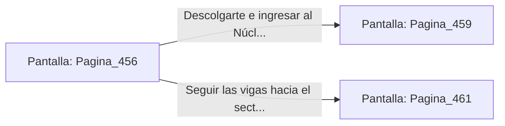

# 📺 Nodo Pantalla: `Pagina_456`

[[Index|⬅️ Índice]] | Fichero Origen: [[sample_eligejuego-code_capitulo_24_mpl|📄 sample/eligejuego-code/capitulo_24.mpl]]

**Narrativa y Encabezado:**
> PÁGINA 456: EVASIÓN POR LAS VIGAS
> 
> Disparas tu gancho y te elevas hacia las vigas de soporte del techo, esquivando el barrido de la sierra térmica del autómata. Avanzas a paso ligero por la estructura metálica hasta superar la zona de patrulla.
> 
> Te descuelgas limpiamente al otro lado de la pasarela frente al portón de la fundición.

## 📋 Desglose de Instrucciones de Opciones
### `OPCION "Descolgarte e ingresar al Núcleo de Fundición" CON_ACCION TRANSICIONAR_A Pagina_459`
* **Instrucción:** `OPCION` *(Manual: Mapea una entrada o botón interactivo de usuario. Vincular una acción como la invocación de una función C1, un método C2 o una transición C3.)*
* **Efecto de Control:** Dispara `TRANSICIONAR_A` hacia [[Pantalla_Pagina_459|📺 Pagina_459]]
### `OPCION "Seguir las vigas hacia el sector de ensamblaje" CON_ACCION TRANSICIONAR_A Pagina_461`
* **Instrucción:** `OPCION` *(Manual: Mapea una entrada o botón interactivo de usuario. Vincular una acción como la invocación de una función C1, un método C2 o una transición C3.)*
* **Efecto de Control:** Dispara `TRANSICIONAR_A` hacia [[Pantalla_Pagina_461|📺 Pagina_461]]

## 📊 Diagrama de Flujo e Interacción (Mermaid)

