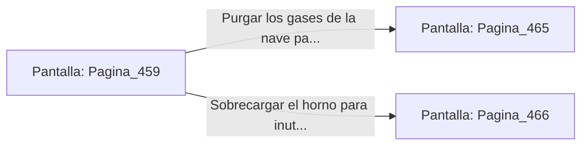

# 📺 Nodo Pantalla: `Pagina_459`

[[Index|⬅️ Índice]] | Fichero Origen: [[sample_eligejuego-code_capitulo_24_mpl|📄 sample/eligejuego-code/capitulo_24.mpl]]

**Narrativa y Encabezado:**
> PÁGINA 459: EL NÚCLEO DE FUNDICIÓN
> 
> Deslizas la tarjeta de acceso por la ranura rúnica e ingresas al monumental Núcleo de Fundición. Una columna gigante de fuego estelar calienta el titanio en el centro de la nave, mientras brazos robóticos moldean placas de blindaje pesado.
> 
> En la consola principal brilla una Tarjeta de Nivel Siete y un conmutador que permite purgar los gases de la nave o sobrecargar el horno principal.
> 
> Sincronizas la Tarjeta de Nivel Siete en tu Brazal de Convergencia antes de operar los mandos de la consola.

## 📋 Desglose de Instrucciones de Opciones
### `OPCION "Purgar los gases de la nave para asegurar el pasaje" CON_ACCION TRANSICIONAR_A Pagina_465`
* **Instrucción:** `OPCION` *(Manual: Mapea una entrada o botón interactivo de usuario. Vincular una acción como la invocación de una función C1, un método C2 o una transición C3.)*
* **Efecto de Control:** Dispara `TRANSICIONAR_A` hacia [[Pantalla_Pagina_465|📺 Pagina_465]]
### `OPCION "Sobrecargar el horno para inutilizar los autómatas del sector" CON_ACCION TRANSICIONAR_A Pagina_466`
* **Instrucción:** `OPCION` *(Manual: Mapea una entrada o botón interactivo de usuario. Vincular una acción como la invocación de una función C1, un método C2 o una transición C3.)*
* **Efecto de Control:** Dispara `TRANSICIONAR_A` hacia [[Pantalla_Pagina_466|📺 Pagina_466]]

## 📊 Diagrama de Flujo e Interacción (Mermaid)

