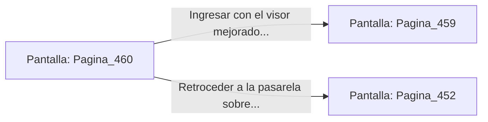

# 📺 Nodo Pantalla: `Pagina_460`

[[Index|⬅️ Índice]] | Fichero Origen: [[sample_eligejuego-code_capitulo_24_mpl|📄 sample/eligejuego-code/capitulo_24.mpl]]

**Narrativa y Encabezado:**
> PÁGINA 460: REVISIÓN DE CARTUCHOS
> 
> Examinas los anaqueles del armario y recuperas un cristal de enfoque térmico para adosarlo a tu arma de fase.
> 
> Con la mejora lista, te adentras con la tarjeta al Núcleo de Fundición.

## 📋 Desglose de Instrucciones de Opciones
### `OPCION "Ingresar con el visor mejorado al Núcleo de Fundición" CON_ACCION TRANSICIONAR_A Pagina_459`
* **Instrucción:** `OPCION` *(Manual: Mapea una entrada o botón interactivo de usuario. Vincular una acción como la invocación de una función C1, un método C2 o una transición C3.)*
* **Efecto de Control:** Dispara `TRANSICIONAR_A` hacia [[Pantalla_Pagina_459|📺 Pagina_459]]
### `OPCION "Retroceder a la pasarela sobre los crisoles" CON_ACCION TRANSICIONAR_A Pagina_452`
* **Instrucción:** `OPCION` *(Manual: Mapea una entrada o botón interactivo de usuario. Vincular una acción como la invocación de una función C1, un método C2 o una transición C3.)*
* **Efecto de Control:** Dispara `TRANSICIONAR_A` hacia [[Pantalla_Pagina_452|📺 Pagina_452]]

## 📊 Diagrama de Flujo e Interacción (Mermaid)

