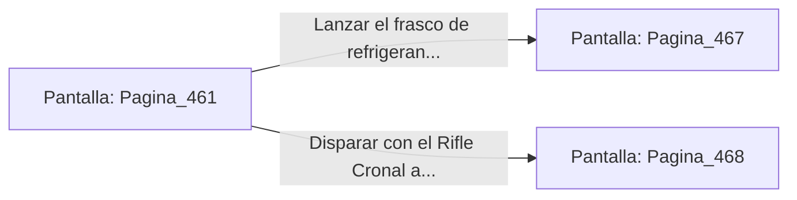

# 📺 Nodo Pantalla: `Pagina_461`

[[Index|⬅️ Índice]] | Fichero Origen: [[sample_eligejuego-code_capitulo_24_mpl|📄 sample/eligejuego-code/capitulo_24.mpl]]

**Narrativa y Encabezado:**
> PÁGINA 461: EL SECTOR DE ENSAMBLAJE PESADO
> 
> Te descuelgas al piso del Sector de Ensamblaje Pesado. Enormes prensas neumáticas ensamblan las placas de titanio sobre chasis de autómatas de combate en una cadena de montaje automatizada.
> 
> Un autómata pesado de asalto en fase final de ensamblaje bloquea la salida con su cañón térmico cargado. La unidad detecta tu firma de energía e inicia el protocolo de erradicación.
> 
> Puedes usar tu frasco de refrigerante alquímico para congelar sus servos o disparar a los tubos de presión de la prensa neumática superior.

## 📋 Desglose de Instrucciones de Opciones
### `OPCION "Lanzar el frasco de refrigerante para congelar al autómata" CON_ACCION TRANSICIONAR_A Pagina_467`
* **Instrucción:** `OPCION` *(Manual: Mapea una entrada o botón interactivo de usuario. Vincular una acción como la invocación de una función C1, un método C2 o una transición C3.)*
* **Efecto de Control:** Dispara `TRANSICIONAR_A` hacia [[Pantalla_Pagina_467|📺 Pagina_467]]
### `OPCION "Disparar con el Rifle Cronal a las tuberías de la prensa superior" CON_ACCION TRANSICIONAR_A Pagina_468`
* **Instrucción:** `OPCION` *(Manual: Mapea una entrada o botón interactivo de usuario. Vincular una acción como la invocación de una función C1, un método C2 o una transición C3.)*
* **Efecto de Control:** Dispara `TRANSICIONAR_A` hacia [[Pantalla_Pagina_468|📺 Pagina_468]]

## 📊 Diagrama de Flujo e Interacción (Mermaid)

