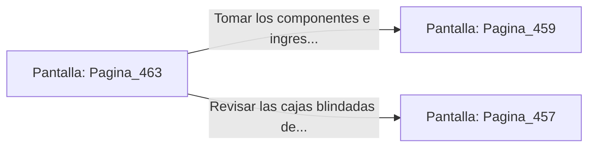

# 📺 Nodo Pantalla: `Pagina_463`

[[Index|⬅️ Índice]] | Fichero Origen: [[sample_eligejuego-code_capitulo_24_mpl|📄 sample/eligejuego-code/capitulo_24.mpl]]

**Narrativa y Encabezado:**
> PÁGINA 463: LA NAVE DE DISTRIBUCIÓN DE LINGOTES
> 
> Ingresas en la Nave de Distribución de Lingotes. Filas de lingotes de titanio y éter mineralizado descansan en bastidores blindados listos para ser transportados a los niveles superiores.
> 
> En la peana central reposa un frasco de lubricante arcano de alta densidad y una clave de anulación para los sensores ópticos de la fundición.
> 
> Sincronizas la clave en tu Brazal y te apoderas del lubricante antes de avanzar a la consola central.

## 📋 Desglose de Instrucciones de Opciones
### `OPCION "Tomar los componentes e ingresar al Núcleo de Fundición" CON_ACCION TRANSICIONAR_A Pagina_459`
* **Instrucción:** `OPCION` *(Manual: Mapea una entrada o botón interactivo de usuario. Vincular una acción como la invocación de una función C1, un método C2 o una transición C3.)*
* **Efecto de Control:** Dispara `TRANSICIONAR_A` hacia [[Pantalla_Pagina_459|📺 Pagina_459]]
### `OPCION "Revisar las cajas blindadas de la nave" CON_ACCION TRANSICIONAR_A Pagina_457`
* **Instrucción:** `OPCION` *(Manual: Mapea una entrada o botón interactivo de usuario. Vincular una acción como la invocación de una función C1, un método C2 o una transición C3.)*
* **Efecto de Control:** Dispara `TRANSICIONAR_A` hacia [[Pantalla_Pagina_457|📺 Pagina_457]]

## 📊 Diagrama de Flujo e Interacción (Mermaid)

