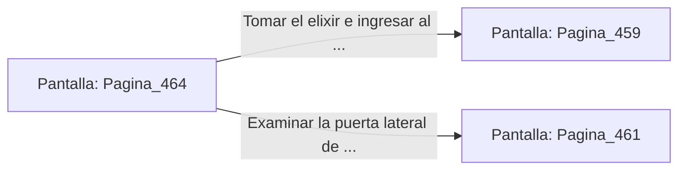

# 📺 Nodo Pantalla: `Pagina_464`

[[Index|⬅️ Índice]] | Fichero Origen: [[sample_eligejuego-code_capitulo_24_mpl|📄 sample/eligejuego-code/capitulo_24.mpl]]

**Narrativa y Encabezado:**
> PÁGINA 464: PASADIZO DE LOS FORJADORES
> 
> Avanzas por el pasadizo privado de los antiguos maestros forjadores. Las paredes revestidas de placas de hierro pulido amortiguan el ruido de los martillos neumático.
> 
> Al final de la galería hallas una hornacina con un vial de elixir regenerativo.

## 📋 Desglose de Instrucciones de Opciones
### `OPCION "Tomar el elixir e ingresar al Núcleo de Fundición" CON_ACCION TRANSICIONAR_A Pagina_459`
* **Instrucción:** `OPCION` *(Manual: Mapea una entrada o botón interactivo de usuario. Vincular una acción como la invocación de una función C1, un método C2 o una transición C3.)*
* **Efecto de Control:** Dispara `TRANSICIONAR_A` hacia [[Pantalla_Pagina_459|📺 Pagina_459]]
### `OPCION "Examinar la puerta lateral de los talleres" CON_ACCION TRANSICIONAR_A Pagina_461`
* **Instrucción:** `OPCION` *(Manual: Mapea una entrada o botón interactivo de usuario. Vincular una acción como la invocación de una función C1, un método C2 o una transición C3.)*
* **Efecto de Control:** Dispara `TRANSICIONAR_A` hacia [[Pantalla_Pagina_461|📺 Pagina_461]]

## 📊 Diagrama de Flujo e Interacción (Mermaid)

