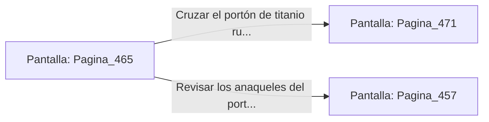

# 📺 Nodo Pantalla: `Pagina_465`

[[Index|⬅️ Índice]] | Fichero Origen: [[sample_eligejuego-code_capitulo_24_mpl|📄 sample/eligejuego-code/capitulo_24.mpl]]

**Narrativa y Encabezado:**
> PÁGINA 465: EL PASO HACIA EL CAPÍTULO 25
> 
> Con la Tarjeta de Nivel Siete autenticada y los gases de la nave purgados limpia y seguidamente, el gran portón acorazado de titanio del extremo norte se abre en dos mitades.
> 
> Ante ti se despliega la calzada iluminada por luz dorada que conduce hacia las Cámaras del Capítulo 25, donde se encuentran los Archivos Centrales de la Dinastía.
> 
> Verificas tus armas y tu equipo de protección antes de cruzar el umbral con paso firme.

## 📋 Desglose de Instrucciones de Opciones
### `OPCION "Cruzar el portón de titanio rumbo al Capítulo 25" CON_ACCION TRANSICIONAR_A Pagina_471`
* **Instrucción:** `OPCION` *(Manual: Mapea una entrada o botón interactivo de usuario. Vincular una acción como la invocación de una función C1, un método C2 o una transición C3.)*
* **Efecto de Control:** Dispara `TRANSICIONAR_A` hacia [[Pantalla_Pagina_471|📺 Pagina_471]]
### `OPCION "Revisar los anaqueles del portón en busca de suministros" CON_ACCION TRANSICIONAR_A Pagina_457`
* **Instrucción:** `OPCION` *(Manual: Mapea una entrada o botón interactivo de usuario. Vincular una acción como la invocación de una función C1, un método C2 o una transición C3.)*
* **Efecto de Control:** Dispara `TRANSICIONAR_A` hacia [[Pantalla_Pagina_457|📺 Pagina_457]]

## 📊 Diagrama de Flujo e Interacción (Mermaid)

