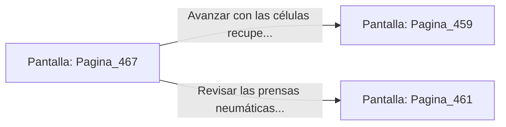

# 📺 Nodo Pantalla: `Pagina_467`

[[Index|⬅️ Índice]] | Fichero Origen: [[sample_eligejuego-code_capitulo_24_mpl|📄 sample/eligejuego-code/capitulo_24.mpl]]

**Narrativa y Encabezado:**
> PÁGINA 467: CONGELACIÓN DEL AUTÓMATA PESADO
> 
> Lanzas el frasco de refrigerante alquímico contra los servos del autómata pesado. La rápida congelación quiebra los circuitos hidráulicos de sus piernas y la máquina cae inmovilizada al suelo de piedra.
> 
> Aprovechas su parálisis para rematar el núcleo de su espalda con una estocada precisa de tu arma de fase, desactivándolo por completo.
> 
> Recoges las células de energía de los restos y te encaminas a la salida del sector de ensamblaje.

## 📋 Desglose de Instrucciones de Opciones
### `OPCION "Avanzar con las células recuperadas hacia el Núcleo de Fundición" CON_ACCION TRANSICIONAR_A Pagina_459`
* **Instrucción:** `OPCION` *(Manual: Mapea una entrada o botón interactivo de usuario. Vincular una acción como la invocación de una función C1, un método C2 o una transición C3.)*
* **Efecto de Control:** Dispara `TRANSICIONAR_A` hacia [[Pantalla_Pagina_459|📺 Pagina_459]]
### `OPCION "Revisar las prensas neumáticas de la nave" CON_ACCION TRANSICIONAR_A Pagina_461`
* **Instrucción:** `OPCION` *(Manual: Mapea una entrada o botón interactivo de usuario. Vincular una acción como la invocación de una función C1, un método C2 o una transición C3.)*
* **Efecto de Control:** Dispara `TRANSICIONAR_A` hacia [[Pantalla_Pagina_461|📺 Pagina_461]]

## 📊 Diagrama de Flujo e Interacción (Mermaid)

