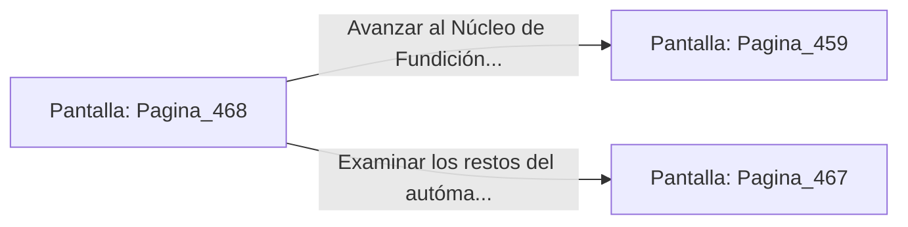

# 📺 Nodo Pantalla: `Pagina_468`

[[Index|⬅️ Índice]] | Fichero Origen: [[sample_eligejuego-code_capitulo_24_mpl|📄 sample/eligejuego-code/capitulo_24.mpl]]

**Narrativa y Encabezado:**
> PÁGINA 468: DERRUMBE DE LA PRENSA NEUMÁTICA
> 
> Disparas con tu Rifle Cronal a las tuberías de alta presión de la prensa neumática superior. La pesada estructura de hierro se desploma directamente sobre el autómata de asalto, aplastándolo bajo toneladas de metal.
> 
> Con el camino libre, cruzas la nave de ensamblaje hacia el portón de salida.

## 📋 Desglose de Instrucciones de Opciones
### `OPCION "Avanzar al Núcleo de Fundición" CON_ACCION TRANSICIONAR_A Pagina_459`
* **Instrucción:** `OPCION` *(Manual: Mapea una entrada o botón interactivo de usuario. Vincular una acción como la invocación de una función C1, un método C2 o una transición C3.)*
* **Efecto de Control:** Dispara `TRANSICIONAR_A` hacia [[Pantalla_Pagina_459|📺 Pagina_459]]
### `OPCION "Examinar los restos del autómata aplastado" CON_ACCION TRANSICIONAR_A Pagina_467`
* **Instrucción:** `OPCION` *(Manual: Mapea una entrada o botón interactivo de usuario. Vincular una acción como la invocación de una función C1, un método C2 o una transición C3.)*
* **Efecto de Control:** Dispara `TRANSICIONAR_A` hacia [[Pantalla_Pagina_467|📺 Pagina_467]]

## 📊 Diagrama de Flujo e Interacción (Mermaid)

