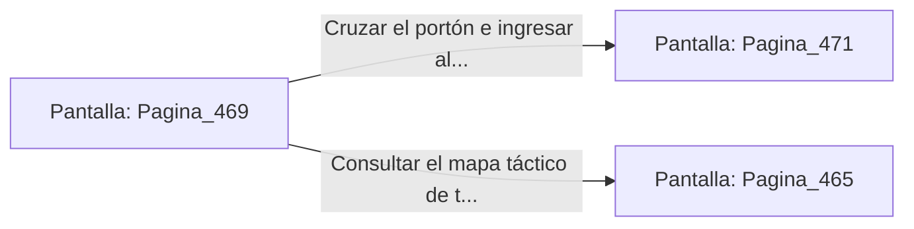

# 📺 Nodo Pantalla: `Pagina_469`

[[Index|⬅️ Índice]] | Fichero Origen: [[sample_eligejuego-code_capitulo_24_mpl|📄 sample/eligejuego-code/capitulo_24.mpl]]

**Narrativa y Encabezado:**
> PÁGINA 469: EL TRÍUNFO EN LAS FORJAS DE TITANIO
> 
> Atraviesas las naves purificadas de los Talleres de Forja de Titanio llevando la Tarjeta de Nivel Siete y tus reservas curativas reabastecidas. El calor sofocante disminuye paulatinamente mientras te aproximas al portal norte.
> 
> Tu Brazal de Convergencia confirma que las Cámaras 451 a 470 han sido estabilizadas con éxito dentro de la red del complejo.
> 
> Te detienes un segundo frente al portón del Capítulo 25 con la satisfacción del deber cumplido.

## 📋 Desglose de Instrucciones de Opciones
### `OPCION "Cruzar el portón e ingresar al Capítulo 25" CON_ACCION TRANSICIONAR_A Pagina_471`
* **Instrucción:** `OPCION` *(Manual: Mapea una entrada o botón interactivo de usuario. Vincular una acción como la invocación de una función C1, un método C2 o una transición C3.)*
* **Efecto de Control:** Dispara `TRANSICIONAR_A` hacia [[Pantalla_Pagina_471|📺 Pagina_471]]
### `OPCION "Consultar el mapa táctico de tu Brazal" CON_ACCION TRANSICIONAR_A Pagina_465`
* **Instrucción:** `OPCION` *(Manual: Mapea una entrada o botón interactivo de usuario. Vincular una acción como la invocación de una función C1, un método C2 o una transición C3.)*
* **Efecto de Control:** Dispara `TRANSICIONAR_A` hacia [[Pantalla_Pagina_465|📺 Pagina_465]]

## 📊 Diagrama de Flujo e Interacción (Mermaid)

