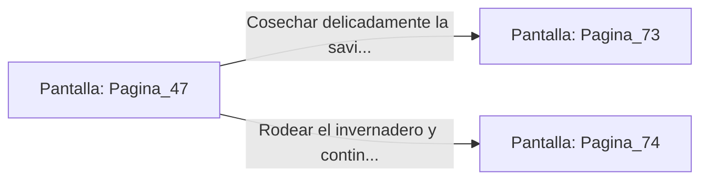

# 📺 Nodo Pantalla: `Pagina_47`

[[Index|⬅️ Índice]] | Fichero Origen: [[sample_eligejuego-code_capitulo_03_mpl|📄 sample/eligejuego-code/capitulo_03.mpl]]

**Narrativa y Encabezado:**
> PÁGINA 47: EL JARDÍN DE CRISTAL
> 
> Llegas a un invernadero subterráneo donde crecen plantas bioluminiscentes con hojas de cristal translúcido. El aire aquí es dulce y aromático, aunque una corriente magmática subterránea mantiene el ambiente a una temperatura tropical.
> 
> En el centro del jardín crecen las flores de Éter, cuya savia es capaz de revitalizar cualquier organismo al instante. No obstante, una colmena de avispas biomecánicas revolotea alrededor de la flor reina.
> 
> Puedes intentar cosechar la savia con extrema delicadeza o rodear el invernadero para evitar el riesgo de las picaduras térmicas.

## 📋 Desglose de Instrucciones de Opciones
### `OPCION "Cosechar delicadamente la savia de la flor reina de Éter" CON_ACCION TRANSICIONAR_A Pagina_73`
* **Instrucción:** `OPCION` *(Manual: Mapea una entrada o botón interactivo de usuario. Vincular una acción como la invocación de una función C1, un método C2 o una transición C3.)*
* **Efecto de Control:** Dispara `TRANSICIONAR_A` hacia [[Pantalla_Pagina_73|📺 Pagina_73]]
### `OPCION "Rodear el invernadero y continuar hacia los Bastiones" CON_ACCION TRANSICIONAR_A Pagina_74`
* **Instrucción:** `OPCION` *(Manual: Mapea una entrada o botón interactivo de usuario. Vincular una acción como la invocación de una función C1, un método C2 o una transición C3.)*
* **Efecto de Control:** Dispara `TRANSICIONAR_A` hacia [[Pantalla_Pagina_74|📺 Pagina_74]]

## 📊 Diagrama de Flujo e Interacción (Mermaid)

