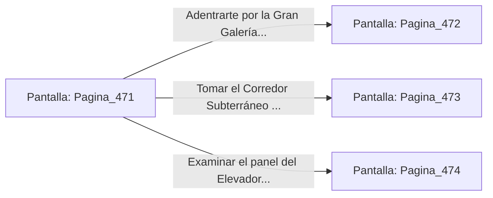

# 📺 Nodo Pantalla: `Pagina_471`

[[Index|⬅️ Índice]] | Fichero Origen: [[sample_eligejuego-code_capitulo_25_mpl|📄 sample/eligejuego-code/capitulo_25.mpl]]

**Narrativa y Encabezado:**
> PÁGINA 471: EL UMBRAL DE LOS ARCHIVOS CENTRALES
> 
> Atraviesas el portón de titanio y accedes a la majestuosa nave de los Archivos Centrales de la Dinastía. Gigantescas estanterías de mármol negro revestidas con apliques de bronce se elevan hasta el techo abovedado, custodiando miles de tomos encuadernados en aleación rúnica y discos de cristal con la memoria histórica de Aethelgard.
> 
> Tu Brazal de Convergencia registra que las Cámaras 471 a 490 resguardan las claves lógicas de los últimos niveles del Núcleo. Centinelas Lexicográficos provistos de escáneres ópticos y cuchillas de inducción patrullan las pasarelas superiores entre una tenue niebla de luz azulina.
> 
> Frente a ti se despliegan tres vías para explorar los archivos: la Gran Galería de los Códices, el Corredor Subterráneo de los Manuscritos y el Elevador Neumático de la Gran Librería.

## 📋 Desglose de Instrucciones de Opciones
### `OPCION "Adentrarte por la Gran Galería de los Códices" CON_ACCION TRANSICIONAR_A Pagina_472`
* **Instrucción:** `OPCION` *(Manual: Mapea una entrada o botón interactivo de usuario. Vincular una acción como la invocación de una función C1, un método C2 o una transición C3.)*
* **Efecto de Control:** Dispara `TRANSICIONAR_A` hacia [[Pantalla_Pagina_472|📺 Pagina_472]]
### `OPCION "Tomar el Corredor Subterráneo de los Manuscritos" CON_ACCION TRANSICIONAR_A Pagina_473`
* **Instrucción:** `OPCION` *(Manual: Mapea una entrada o botón interactivo de usuario. Vincular una acción como la invocación de una función C1, un método C2 o una transición C3.)*
* **Efecto de Control:** Dispara `TRANSICIONAR_A` hacia [[Pantalla_Pagina_473|📺 Pagina_473]]
### `OPCION "Examinar el panel del Elevador Neumático de la Gran Librería" CON_ACCION TRANSICIONAR_A Pagina_474`
* **Instrucción:** `OPCION` *(Manual: Mapea una entrada o botón interactivo de usuario. Vincular una acción como la invocación de una función C1, un método C2 o una transición C3.)*
* **Efecto de Control:** Dispara `TRANSICIONAR_A` hacia [[Pantalla_Pagina_474|📺 Pagina_474]]

## 📊 Diagrama de Flujo e Interacción (Mermaid)

