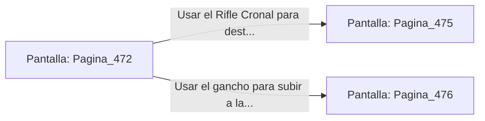

# 📺 Nodo Pantalla: `Pagina_472`

[[Index|⬅️ Índice]] | Fichero Origen: [[sample_eligejuego-code_capitulo_25_mpl|📄 sample/eligejuego-code/capitulo_25.mpl]]

**Narrativa y Encabezado:**
> PÁGINA 472: LA GRAN GALERÍA DE LOS CÓDICES
> 
> Avanzas con sigilo sobre la alfombra carmesí que amortigua tus pisadas entre los anaqueles de piedra. El aire huele a ozono y a pergamino preservado en suero estático, mientras las luces de cristal parpadean suavemente en las paredes.
> 
> A mitad de la galería, dos Centinelas Lexicográficos descienden de las pasarelas superiores con sus cuchillas de inducción activadas.

## 📋 Desglose de Instrucciones de Opciones
### `OPCION "Usar el Rifle Cronal para destruir los sensores ópticos de los centinelas" CON_ACCION TRANSICIONAR_A Pagina_475`
* **Instrucción:** `OPCION` *(Manual: Mapea una entrada o botón interactivo de usuario. Vincular una acción como la invocación de una función C1, un método C2 o una transición C3.)*
* **Efecto de Control:** Dispara `TRANSICIONAR_A` hacia [[Pantalla_Pagina_475|📺 Pagina_475]]
### `OPCION "Usar el gancho para subir a la cornisa del anaquel superior" CON_ACCION TRANSICIONAR_A Pagina_476`
* **Instrucción:** `OPCION` *(Manual: Mapea una entrada o botón interactivo de usuario. Vincular una acción como la invocación de una función C1, un método C2 o una transición C3.)*
* **Efecto de Control:** Dispara `TRANSICIONAR_A` hacia [[Pantalla_Pagina_476|📺 Pagina_476]]

## 📊 Diagrama de Flujo e Interacción (Mermaid)

