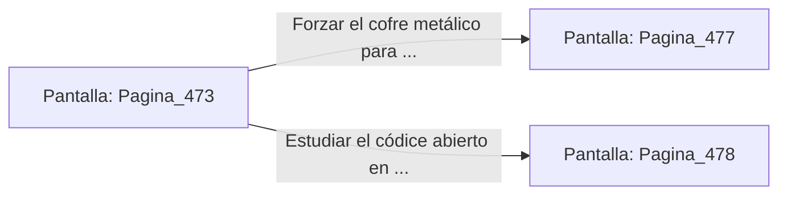

# 📺 Nodo Pantalla: `Pagina_473`

[[Index|⬅️ Índice]] | Fichero Origen: [[sample_eligejuego-code_capitulo_25_mpl|📄 sample/eligejuego-code/capitulo_25.mpl]]

**Narrativa y Encabezado:**
> PÁGINA 473: EL CORREDOR SUBTERRÁNEO DE LOS MANUSCRITOS
> 
> Te introduces en el angosto corredor subterráneo revestido de placas de bronce pulido. En las hornacinas laterales flotan esferas de cristal que contienen los decretos imperiales firmados antes de la corrupción de Malakor.
> 
> Tras superar el tramo central, alcanzas un escritorio de lecturas de teca donde descansa un códice abierto y un cofre metálico con el sello de los antiguos archiveros.
> 
> Tienes la opción de forzar el cofre para recuperar tónicos de salud o estudiar el códice abierto en busca de códigos de desactivación.

## 📋 Desglose de Instrucciones de Opciones
### `OPCION "Forzar el cofre metálico para recuperar tónicos de salud" CON_ACCION TRANSICIONAR_A Pagina_477`
* **Instrucción:** `OPCION` *(Manual: Mapea una entrada o botón interactivo de usuario. Vincular una acción como la invocación de una función C1, un método C2 o una transición C3.)*
* **Efecto de Control:** Dispara `TRANSICIONAR_A` hacia [[Pantalla_Pagina_477|📺 Pagina_477]]
### `OPCION "Estudiar el códice abierto en busca de códigos de desactivación" CON_ACCION TRANSICIONAR_A Pagina_478`
* **Instrucción:** `OPCION` *(Manual: Mapea una entrada o botón interactivo de usuario. Vincular una acción como la invocación de una función C1, un método C2 o una transición C3.)*
* **Efecto de Control:** Dispara `TRANSICIONAR_A` hacia [[Pantalla_Pagina_478|📺 Pagina_478]]

## 📊 Diagrama de Flujo e Interacción (Mermaid)

