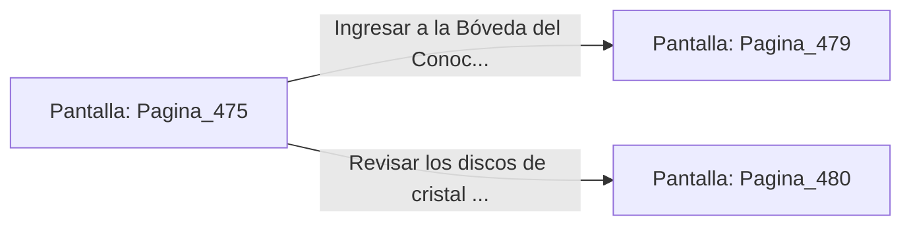

# 📺 Nodo Pantalla: `Pagina_475`

[[Index|⬅️ Índice]] | Fichero Origen: [[sample_eligejuego-code_capitulo_25_mpl|📄 sample/eligejuego-code/capitulo_25.mpl]]

**Narrativa y Encabezado:**
> PÁGINA 475: FUEGO PRECISO EN LOS CÓDICES
> 
> Alineas la mira del Rifle Cronal y descargas dos ráfagas de aceleración sobre los sensores ópticos de los Centinelas Lexicográficos. Ciegos y desorientados, los dos autómatas colisionan contra los estantes de mármol y colapsan inanimados sobre el suelo.
> 
> Con la galería libre, alcanzas el escritorio central donde un compartimento secreto permanece entreabierto. En su interior hallas dos Células de Éter Sobrecargadas y la Tarjeta de Acceso a la Bóveda del Conocimiento.
> 
> Guardas los objetos en tu arnés táctico antes de dirigirte a la entrada de la Bóveda del Conocimiento.

## 📋 Desglose de Instrucciones de Opciones
### `OPCION "Ingresar a la Bóveda del Conocimiento con la tarjeta de acceso" CON_ACCION TRANSICIONAR_A Pagina_479`
* **Instrucción:** `OPCION` *(Manual: Mapea una entrada o botón interactivo de usuario. Vincular una acción como la invocación de una función C1, un método C2 o una transición C3.)*
* **Efecto de Control:** Dispara `TRANSICIONAR_A` hacia [[Pantalla_Pagina_479|📺 Pagina_479]]
### `OPCION "Revisar los discos de cristal del escritorio central" CON_ACCION TRANSICIONAR_A Pagina_480`
* **Instrucción:** `OPCION` *(Manual: Mapea una entrada o botón interactivo de usuario. Vincular una acción como la invocación de una función C1, un método C2 o una transición C3.)*
* **Efecto de Control:** Dispara `TRANSICIONAR_A` hacia [[Pantalla_Pagina_480|📺 Pagina_480]]

## 📊 Diagrama de Flujo e Interacción (Mermaid)

