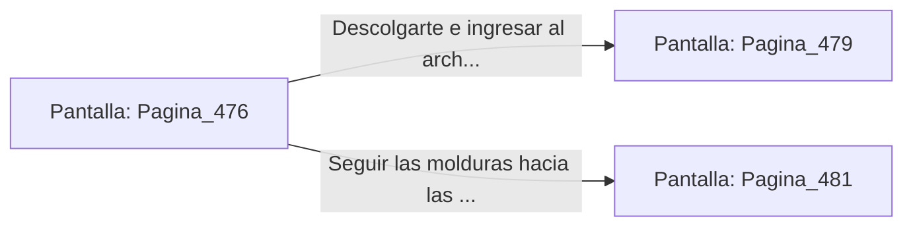

# 📺 Nodo Pantalla: `Pagina_476`

[[Index|⬅️ Índice]] | Fichero Origen: [[sample_eligejuego-code_capitulo_25_mpl|📄 sample/eligejuego-code/capitulo_25.mpl]]

**Narrativa y Encabezado:**
> PÁGINA 476: EVASIÓN POR LA CORNISA SUPERIOR
> 
> Disparas el gancho y te elevas hacia la cornisa de mármol del anaquel, dejando abajo a los dos centinelas. Avanzas por la moldura con agilidad hasta superar la zona de vigilancia.
> 
> Te descuelgas al otro lado de la galería frente a la puerta del archivo restringido.

## 📋 Desglose de Instrucciones de Opciones
### `OPCION "Descolgarte e ingresar al archivo restringido" CON_ACCION TRANSICIONAR_A Pagina_479`
* **Instrucción:** `OPCION` *(Manual: Mapea una entrada o botón interactivo de usuario. Vincular una acción como la invocación de una función C1, un método C2 o una transición C3.)*
* **Efecto de Control:** Dispara `TRANSICIONAR_A` hacia [[Pantalla_Pagina_479|📺 Pagina_479]]
### `OPCION "Seguir las molduras hacia las bóvedas de mapas" CON_ACCION TRANSICIONAR_A Pagina_481`
* **Instrucción:** `OPCION` *(Manual: Mapea una entrada o botón interactivo de usuario. Vincular una acción como la invocación de una función C1, un método C2 o una transición C3.)*
* **Efecto de Control:** Dispara `TRANSICIONAR_A` hacia [[Pantalla_Pagina_481|📺 Pagina_481]]

## 📊 Diagrama de Flujo e Interacción (Mermaid)

