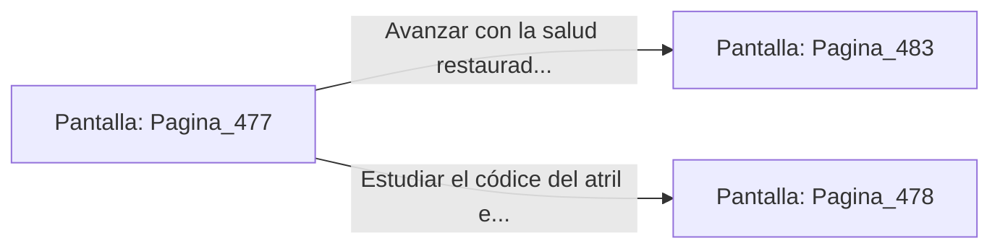

# 📺 Nodo Pantalla: `Pagina_477`

[[Index|⬅️ Índice]] | Fichero Origen: [[sample_eligejuego-code_capitulo_25_mpl|📄 sample/eligejuego-code/capitulo_25.mpl]]

**Narrativa y Encabezado:**
> PÁGINA 477: LOS TÓNICOS DE LOS ARCHIVEROS
> 
> Fuerzas la cerradura del cofre metálico con la estaca rúnica de tu Brazal. La tapa cede para revelar dos viales de Suero Reconstituyente y una bomba de humo térmico de alta densidad.
> 
> Consumes uno de los viales de suero, sintiendo una agradable sensación de alivio que sana el desgaste físico y reabastece por completo tus reservas de salud.
> 
> Con los componentes seguros en tus bolsillos, reanudas la marcha hacia la sala de los decretos imperiales.

## 📋 Desglose de Instrucciones de Opciones
### `OPCION "Avanzar con la salud restaurada hacia la sala de los decretos" CON_ACCION TRANSICIONAR_A Pagina_483`
* **Instrucción:** `OPCION` *(Manual: Mapea una entrada o botón interactivo de usuario. Vincular una acción como la invocación de una función C1, un método C2 o una transición C3.)*
* **Efecto de Control:** Dispara `TRANSICIONAR_A` hacia [[Pantalla_Pagina_483|📺 Pagina_483]]
### `OPCION "Estudiar el códice del atril en busca de información" CON_ACCION TRANSICIONAR_A Pagina_478`
* **Instrucción:** `OPCION` *(Manual: Mapea una entrada o botón interactivo de usuario. Vincular una acción como la invocación de una función C1, un método C2 o una transición C3.)*
* **Efecto de Control:** Dispara `TRANSICIONAR_A` hacia [[Pantalla_Pagina_478|📺 Pagina_478]]

## 📊 Diagrama de Flujo e Interacción (Mermaid)

