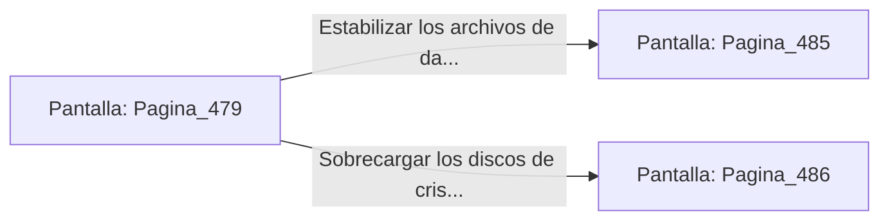

# 📺 Nodo Pantalla: `Pagina_479`

[[Index|⬅️ Índice]] | Fichero Origen: [[sample_eligejuego-code_capitulo_25_mpl|📄 sample/eligejuego-code/capitulo_25.mpl]]

**Narrativa y Encabezado:**
> PÁGINA 479: LA BÓVEDA DEL CONOCIMIENTO
> 
> Deslizas la tarjeta de acceso por la ranura rúnica e ingresas a la vasta Bóveda del Conocimiento. Esferas de luz dorada flotan sobre un mapa holográfico interactivo que representa las 600 Cámaras del Cronoclave.
> 
> En la consola principal brilla la Tarjeta de Nivel Ocho y un conmutador de purga de datos que permite estabilizar el sistema o sobrecargar los archivos.
> 
> Sincronizas la Tarjeta de Nivel Ocho en tu Brazal de Convergencia antes de operar la consola.

## 📋 Desglose de Instrucciones de Opciones
### `OPCION "Estabilizar los archivos de datos en la consola central" CON_ACCION TRANSICIONAR_A Pagina_485`
* **Instrucción:** `OPCION` *(Manual: Mapea una entrada o botón interactivo de usuario. Vincular una acción como la invocación de una función C1, un método C2 o una transición C3.)*
* **Efecto de Control:** Dispara `TRANSICIONAR_A` hacia [[Pantalla_Pagina_485|📺 Pagina_485]]
### `OPCION "Sobrecargar los discos de cristal para neutralizar la guardia" CON_ACCION TRANSICIONAR_A Pagina_486`
* **Instrucción:** `OPCION` *(Manual: Mapea una entrada o botón interactivo de usuario. Vincular una acción como la invocación de una función C1, un método C2 o una transición C3.)*
* **Efecto de Control:** Dispara `TRANSICIONAR_A` hacia [[Pantalla_Pagina_486|📺 Pagina_486]]

## 📊 Diagrama de Flujo e Interacción (Mermaid)

