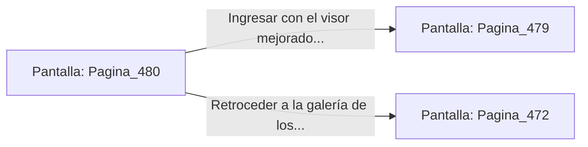

# 📺 Nodo Pantalla: `Pagina_480`

[[Index|⬅️ Índice]] | Fichero Origen: [[sample_eligejuego-code_capitulo_25_mpl|📄 sample/eligejuego-code/capitulo_25.mpl]]

**Narrativa y Encabezado:**
> PÁGINA 480: REVISIÓN DE DISCOS DE CRISTAL
> 
> Examinas los discos de cristal del escritorio y recuperas un visor de enfoque mnemónico que adosas al casco de tu armadura.
> 
> Con la mejora integrada, ingresas a la Bóveda del Conocimiento.

## 📋 Desglose de Instrucciones de Opciones
### `OPCION "Ingresar con el visor mejorado a la Bóveda del Conocimiento" CON_ACCION TRANSICIONAR_A Pagina_479`
* **Instrucción:** `OPCION` *(Manual: Mapea una entrada o botón interactivo de usuario. Vincular una acción como la invocación de una función C1, un método C2 o una transición C3.)*
* **Efecto de Control:** Dispara `TRANSICIONAR_A` hacia [[Pantalla_Pagina_479|📺 Pagina_479]]
### `OPCION "Retroceder a la galería de los códices" CON_ACCION TRANSICIONAR_A Pagina_472`
* **Instrucción:** `OPCION` *(Manual: Mapea una entrada o botón interactivo de usuario. Vincular una acción como la invocación de una función C1, un método C2 o una transición C3.)*
* **Efecto de Control:** Dispara `TRANSICIONAR_A` hacia [[Pantalla_Pagina_472|📺 Pagina_472]]

## 📊 Diagrama de Flujo e Interacción (Mermaid)

