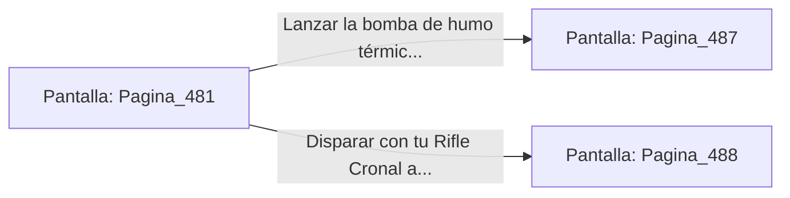

# 📺 Nodo Pantalla: `Pagina_481`

[[Index|⬅️ Índice]] | Fichero Origen: [[sample_eligejuego-code_capitulo_25_mpl|📄 sample/eligejuego-code/capitulo_25.mpl]]

**Narrativa y Encabezado:**
> PÁGINA 481: LA BÓVEDA DE LOS MAPAS TEMPORALES
> 
> Te descuelgas a la Bóveda de los Mapas Temporales. Planos tridimensionales proyectan el flujo de las líneas de tiempo a lo largo de los siglos, revelando la estructura exacta de las últimas cámaras del Núcleo.
> 
> Un autómata guardián de bronce custodia la mesa de mapas esgrimiendo un bastón de descarga cuántica. La unidad detecta tu presencia e inicia el protocolo de erradicación.
> 
> Puedes usar la bomba de humo térmico para cegar sus sensores o disparar con tu Rifle Cronal a los conectores de su bastón.

## 📋 Desglose de Instrucciones de Opciones
### `OPCION "Lanzar la bomba de humo térmico para ciegar al autómata de bronce" CON_ACCION TRANSICIONAR_A Pagina_487`
* **Instrucción:** `OPCION` *(Manual: Mapea una entrada o botón interactivo de usuario. Vincular una acción como la invocación de una función C1, un método C2 o una transición C3.)*
* **Efecto de Control:** Dispara `TRANSICIONAR_A` hacia [[Pantalla_Pagina_487|📺 Pagina_487]]
### `OPCION "Disparar con tu Rifle Cronal a los conectores del bastón" CON_ACCION TRANSICIONAR_A Pagina_488`
* **Instrucción:** `OPCION` *(Manual: Mapea una entrada o botón interactivo de usuario. Vincular una acción como la invocación de una función C1, un método C2 o una transición C3.)*
* **Efecto de Control:** Dispara `TRANSICIONAR_A` hacia [[Pantalla_Pagina_488|📺 Pagina_488]]

## 📊 Diagrama de Flujo e Interacción (Mermaid)

