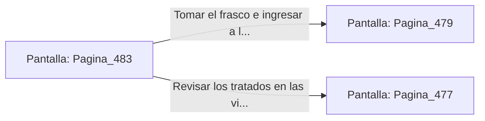

# 📺 Nodo Pantalla: `Pagina_483`

[[Index|⬅️ Índice]] | Fichero Origen: [[sample_eligejuego-code_capitulo_25_mpl|📄 sample/eligejuego-code/capitulo_25.mpl]]

**Narrativa y Encabezado:**
> PÁGINA 483: LA SALA DE LOS DECRETOS IMPERIALES
> 
> Ingresas a la Sala de los Decretos Imperiales. Vitrinas de titanio exhiben los tratados originales de unificación de las 600 Cámaras firmados por el Rey Fundador.
> 
> En la peana central reposa un frasco de Éter Puro Concentrado y una clave de acceso a las bóvedas de los Santuarios del Ápice.
> 
> Te apoderas del frasco y sincronizas la clave en tu Brazal antes de avanzar a la Bóveda del Conocimiento.

## 📋 Desglose de Instrucciones de Opciones
### `OPCION "Tomar el frasco e ingresar a la Bóveda del Conocimiento" CON_ACCION TRANSICIONAR_A Pagina_479`
* **Instrucción:** `OPCION` *(Manual: Mapea una entrada o botón interactivo de usuario. Vincular una acción como la invocación de una función C1, un método C2 o una transición C3.)*
* **Efecto de Control:** Dispara `TRANSICIONAR_A` hacia [[Pantalla_Pagina_479|📺 Pagina_479]]
### `OPCION "Revisar los tratados en las vitrinas de titanio" CON_ACCION TRANSICIONAR_A Pagina_477`
* **Instrucción:** `OPCION` *(Manual: Mapea una entrada o botón interactivo de usuario. Vincular una acción como la invocación de una función C1, un método C2 o una transición C3.)*
* **Efecto de Control:** Dispara `TRANSICIONAR_A` hacia [[Pantalla_Pagina_477|📺 Pagina_477]]

## 📊 Diagrama de Flujo e Interacción (Mermaid)

