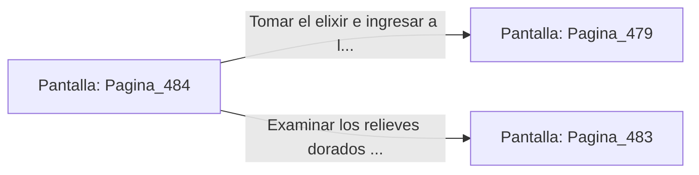

# 📺 Nodo Pantalla: `Pagina_484`

[[Index|⬅️ Índice]] | Fichero Origen: [[sample_eligejuego-code_capitulo_25_mpl|📄 sample/eligejuego-code/capitulo_25.mpl]]

**Narrativa y Encabezado:**
> PÁGINA 484: EL CORREDOR DE LOS CRONISTAS
> 
> Avanzas por el corredor privado de los antiguos cronistas. Las paredes están cubiertas de relieves dorados que narran la historia del Cronoclave.
> 
> Al final del pasillo hallas una hornacina con un vial de elixir regenerativo.

## 📋 Desglose de Instrucciones de Opciones
### `OPCION "Tomar el elixir e ingresar a la Bóveda del Conocimiento" CON_ACCION TRANSICIONAR_A Pagina_479`
* **Instrucción:** `OPCION` *(Manual: Mapea una entrada o botón interactivo de usuario. Vincular una acción como la invocación de una función C1, un método C2 o una transición C3.)*
* **Efecto de Control:** Dispara `TRANSICIONAR_A` hacia [[Pantalla_Pagina_479|📺 Pagina_479]]
### `OPCION "Examinar los relieves dorados del muro" CON_ACCION TRANSICIONAR_A Pagina_483`
* **Instrucción:** `OPCION` *(Manual: Mapea una entrada o botón interactivo de usuario. Vincular una acción como la invocación de una función C1, un método C2 o una transición C3.)*
* **Efecto de Control:** Dispara `TRANSICIONAR_A` hacia [[Pantalla_Pagina_483|📺 Pagina_483]]

## 📊 Diagrama de Flujo e Interacción (Mermaid)

