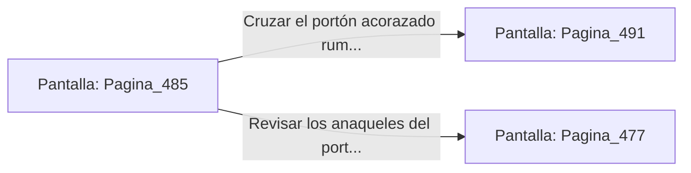

# 📺 Nodo Pantalla: `Pagina_485`

[[Index|⬅️ Índice]] | Fichero Origen: [[sample_eligejuego-code_capitulo_25_mpl|📄 sample/eligejuego-code/capitulo_25.mpl]]

**Narrativa y Encabezado:**
> PÁGINA 485: EL PASO HACIA EL CAPÍTULO 26
> 
> Con la Tarjeta de Nivel Ocho autenticada y los archivos de datos estabilizados en parámetros óptimos, el gran portón acorazado del extremo norte se abre suavemente en dos mitades.
> 
> Ante ti se despliega la calzada iluminada por luz dorada que conduce hacia las Cámaras del Capítulo 26, donde aguardan los Santuarios del Consejo de Sabios.
> 
> Verificas el estado de tu equipo y tus suministros curativos antes de cruzar el umbral con determinación.

## 📋 Desglose de Instrucciones de Opciones
### `OPCION "Cruzar el portón acorazado rumbo al Capítulo 26" CON_ACCION TRANSICIONAR_A Pagina_491`
* **Instrucción:** `OPCION` *(Manual: Mapea una entrada o botón interactivo de usuario. Vincular una acción como la invocación de una función C1, un método C2 o una transición C3.)*
* **Efecto de Control:** Dispara `TRANSICIONAR_A` hacia [[Pantalla_Pagina_491|📺 Pagina_491]]
### `OPCION "Revisar los anaqueles del portón en busca de suministros" CON_ACCION TRANSICIONAR_A Pagina_477`
* **Instrucción:** `OPCION` *(Manual: Mapea una entrada o botón interactivo de usuario. Vincular una acción como la invocación de una función C1, un método C2 o una transición C3.)*
* **Efecto de Control:** Dispara `TRANSICIONAR_A` hacia [[Pantalla_Pagina_477|📺 Pagina_477]]

## 📊 Diagrama de Flujo e Interacción (Mermaid)

