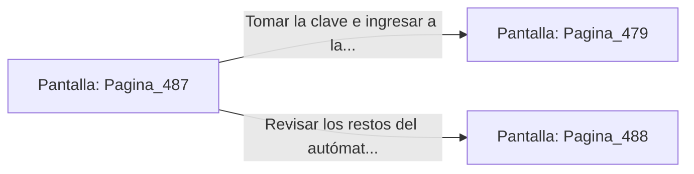

# 📺 Nodo Pantalla: `Pagina_487`

[[Index|⬅️ Índice]] | Fichero Origen: [[sample_eligejuego-code_capitulo_25_mpl|📄 sample/eligejuego-code/capitulo_25.mpl]]

**Narrativa y Encabezado:**
> PÁGINA 487: NEUTRALIZACIÓN EN LOS MAPAS
> 
> Lanzas la bomba de humo térmico a los pies del autómata de bronce. La niebla opaca ciega sus visores y le hace descargar su bastón contra una columna de mármol.
> 
> Aprovechas la confusión para rodear a la máquina y asestar una estocada en el conector de su espalda, desactivándolo por completo.
> 
> Recoges la clave de mapas del pedestal y te encaminas hacia la Bóveda del Conocimiento.

## 📋 Desglose de Instrucciones de Opciones
### `OPCION "Tomar la clave e ingresar a la Bóveda del Conocimiento" CON_ACCION TRANSICIONAR_A Pagina_479`
* **Instrucción:** `OPCION` *(Manual: Mapea una entrada o botón interactivo de usuario. Vincular una acción como la invocación de una función C1, un método C2 o una transición C3.)*
* **Efecto de Control:** Dispara `TRANSICIONAR_A` hacia [[Pantalla_Pagina_479|📺 Pagina_479]]
### `OPCION "Revisar los restos del autómata destruido" CON_ACCION TRANSICIONAR_A Pagina_488`
* **Instrucción:** `OPCION` *(Manual: Mapea una entrada o botón interactivo de usuario. Vincular una acción como la invocación de una función C1, un método C2 o una transición C3.)*
* **Efecto de Control:** Dispara `TRANSICIONAR_A` hacia [[Pantalla_Pagina_488|📺 Pagina_488]]

## 📊 Diagrama de Flujo e Interacción (Mermaid)

