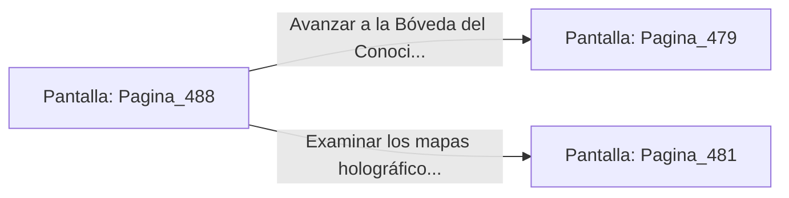

# 📺 Nodo Pantalla: `Pagina_488`

[[Index|⬅️ Índice]] | Fichero Origen: [[sample_eligejuego-code_capitulo_25_mpl|📄 sample/eligejuego-code/capitulo_25.mpl]]

**Narrativa y Encabezado:**
> PÁGINA 488: IMPACTO EN EL BASTÓN CUÁNTICO
> 
> Descargas una ráfaga con el Rifle Cronal directamente sobre los conectores del bastón cuántico. La sobrecarga destruye el arma del autómata, haciéndolo desplomarse sobre las losas.
> 
> Con la sala despejada, te apoderas de las células de energía y avanzas a la salida.

## 📋 Desglose de Instrucciones de Opciones
### `OPCION "Avanzar a la Bóveda del Conocimiento" CON_ACCION TRANSICIONAR_A Pagina_479`
* **Instrucción:** `OPCION` *(Manual: Mapea una entrada o botón interactivo de usuario. Vincular una acción como la invocación de una función C1, un método C2 o una transición C3.)*
* **Efecto de Control:** Dispara `TRANSICIONAR_A` hacia [[Pantalla_Pagina_479|📺 Pagina_479]]
### `OPCION "Examinar los mapas holográficos de la mesa" CON_ACCION TRANSICIONAR_A Pagina_481`
* **Instrucción:** `OPCION` *(Manual: Mapea una entrada o botón interactivo de usuario. Vincular una acción como la invocación de una función C1, un método C2 o una transición C3.)*
* **Efecto de Control:** Dispara `TRANSICIONAR_A` hacia [[Pantalla_Pagina_481|📺 Pagina_481]]

## 📊 Diagrama de Flujo e Interacción (Mermaid)

