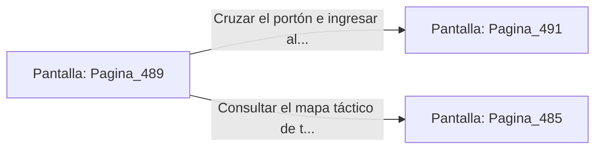

# 📺 Nodo Pantalla: `Pagina_489`

[[Index|⬅️ Índice]] | Fichero Origen: [[sample_eligejuego-code_capitulo_25_mpl|📄 sample/eligejuego-code/capitulo_25.mpl]]

**Narrativa y Encabezado:**
> PÁGINA 489: EL TRIUNFO EN LOS ARCHIVOS CENTRALES
> 
> Atraviesas las naves purificadas de los Archivos Centrales de la Dinastía llevando la Tarjeta de Nivel Ocho y tus reservas curativas reabastecidas. Las luces de los códices brillan con un tono dorado pacífico.
> 
> Tu Brazal de Convergencia confirma que las Cámaras 471 a 490 han sido estabilizadas con éxito dentro de la red del complejo.
> 
> Te detienes frente al portón del Capítulo 26 con la certeza de aproximarte al desenlace de la epopeya.

## 📋 Desglose de Instrucciones de Opciones
### `OPCION "Cruzar el portón e ingresar al Capítulo 26" CON_ACCION TRANSICIONAR_A Pagina_491`
* **Instrucción:** `OPCION` *(Manual: Mapea una entrada o botón interactivo de usuario. Vincular una acción como la invocación de una función C1, un método C2 o una transición C3.)*
* **Efecto de Control:** Dispara `TRANSICIONAR_A` hacia [[Pantalla_Pagina_491|📺 Pagina_491]]
### `OPCION "Consultar el mapa táctico de tu Brazal" CON_ACCION TRANSICIONAR_A Pagina_485`
* **Instrucción:** `OPCION` *(Manual: Mapea una entrada o botón interactivo de usuario. Vincular una acción como la invocación de una función C1, un método C2 o una transición C3.)*
* **Efecto de Control:** Dispara `TRANSICIONAR_A` hacia [[Pantalla_Pagina_485|📺 Pagina_485]]

## 📊 Diagrama de Flujo e Interacción (Mermaid)

