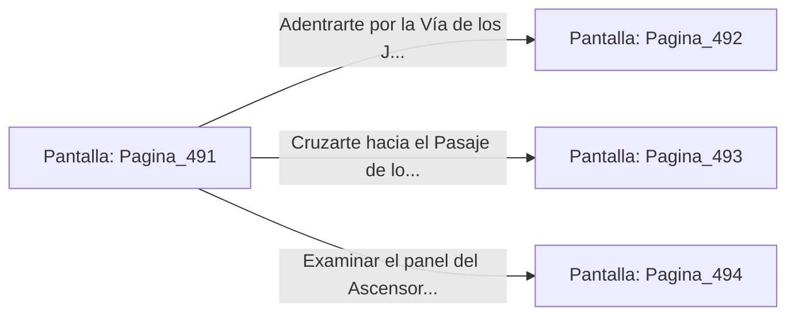

# 📺 Nodo Pantalla: `Pagina_491`

[[Index|⬅️ Índice]] | Fichero Origen: [[sample_eligejuego-code_capitulo_26_mpl|📄 sample/eligejuego-code/capitulo_26.mpl]]

**Narrativa y Encabezado:**
> PÁGINA 491: EL UMBRAL DEL CONSEJO DE SABIOS
> 
> Atraviesas el portón acorazado e ingresas a la sobria nave de los Santuarios del Consejo de Sabios. Columnas de basalto pulido sostienen bóvedas decoradas con constelaciones de cristal de éter, mientras el eco de cánticos arcanos amortiguados resuena en los pasillos de piedra negra.
> 
> Tu Brazal de Convergencia registra que las Cámaras 491 a 510 custodian las claves de acceso al Anillo Interior del Núcleo. Custodios Astrales formados por energía pura y armaduras de titanio patrullan las galerías portando bastones de distorsión espacio-temporal.
> 
> Frente a ti se abren tres vías de avance: la Vía de los Juicios Ancestrales, el Pasaje de los Espejos de Meditación y el Ascensor de los Sabios.

## 📋 Desglose de Instrucciones de Opciones
### `OPCION "Adentrarte por la Vía de los Juicios Ancestrales" CON_ACCION TRANSICIONAR_A Pagina_492`
* **Instrucción:** `OPCION` *(Manual: Mapea una entrada o botón interactivo de usuario. Vincular una acción como la invocación de una función C1, un método C2 o una transición C3.)*
* **Efecto de Control:** Dispara `TRANSICIONAR_A` hacia [[Pantalla_Pagina_492|📺 Pagina_492]]
### `OPCION "Cruzarte hacia el Pasaje de los Espejos de Meditación" CON_ACCION TRANSICIONAR_A Pagina_493`
* **Instrucción:** `OPCION` *(Manual: Mapea una entrada o botón interactivo de usuario. Vincular una acción como la invocación de una función C1, un método C2 o una transición C3.)*
* **Efecto de Control:** Dispara `TRANSICIONAR_A` hacia [[Pantalla_Pagina_493|📺 Pagina_493]]
### `OPCION "Examinar el panel del Ascensor de los Sabios" CON_ACCION TRANSICIONAR_A Pagina_494`
* **Instrucción:** `OPCION` *(Manual: Mapea una entrada o botón interactivo de usuario. Vincular una acción como la invocación de una función C1, un método C2 o una transición C3.)*
* **Efecto de Control:** Dispara `TRANSICIONAR_A` hacia [[Pantalla_Pagina_494|📺 Pagina_494]]

## 📊 Diagrama de Flujo e Interacción (Mermaid)

