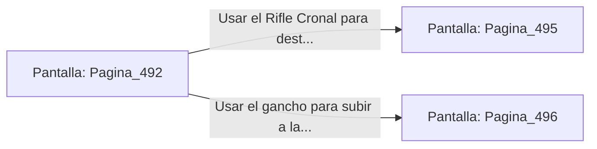

# 📺 Nodo Pantalla: `Pagina_492`

[[Index|⬅️ Índice]] | Fichero Origen: [[sample_eligejuego-code_capitulo_26_mpl|📄 sample/eligejuego-code/capitulo_26.mpl]]

**Narrativa y Encabezado:**
> PÁGINA 492: LA VÍA DE LOS JUICIOS ANCESTRALES
> 
> Avanzas con paso firme sobre las losas de basalto pulido. A ambos lados de la galería, estatuas gigantescas de los primeros consejeros sostienen orbes de luz cian que escanean tu firma de energía a medida que cruzas sus sombras.
> 
> A mitad de camino, dos Custodios Astrales se interponen en la vía, alzando sus bastones de distorsión para bloquear el paso.

## 📋 Desglose de Instrucciones de Opciones
### `OPCION "Usar el Rifle Cronal para destruir los orbes energéticos de los bastones" CON_ACCION TRANSICIONAR_A Pagina_495`
* **Instrucción:** `OPCION` *(Manual: Mapea una entrada o botón interactivo de usuario. Vincular una acción como la invocación de una función C1, un método C2 o una transición C3.)*
* **Efecto de Control:** Dispara `TRANSICIONAR_A` hacia [[Pantalla_Pagina_495|📺 Pagina_495]]
### `OPCION "Usar el gancho para subir a la cornisa del muro lateral" CON_ACCION TRANSICIONAR_A Pagina_496`
* **Instrucción:** `OPCION` *(Manual: Mapea una entrada o botón interactivo de usuario. Vincular una acción como la invocación de una función C1, un método C2 o una transición C3.)*
* **Efecto de Control:** Dispara `TRANSICIONAR_A` hacia [[Pantalla_Pagina_496|📺 Pagina_496]]

## 📊 Diagrama de Flujo e Interacción (Mermaid)

