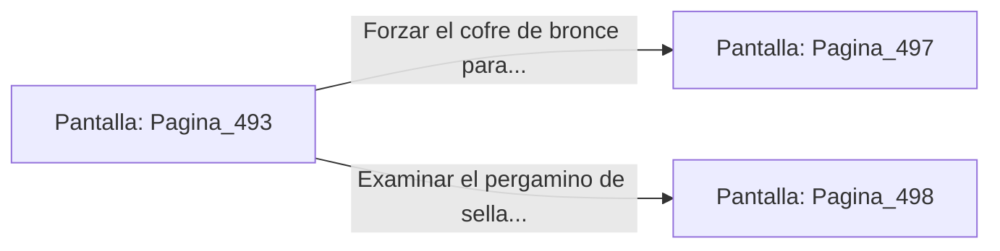

# 📺 Nodo Pantalla: `Pagina_493`

[[Index|⬅️ Índice]] | Fichero Origen: [[sample_eligejuego-code_capitulo_26_mpl|📄 sample/eligejuego-code/capitulo_26.mpl]]

**Narrativa y Encabezado:**
> PÁGINA 493: EL PASAJE DE LOS ESPEJOS DE MEDITACIÓN
> 
> Te adentras por el pasaje flanqueado por espejos de cuarzo negro que reflejan ecos de decisiones no tomadas en líneas temporales alternativas. La distorsión sensorial intenta mermar tu concentración, pero la visera táctica de tu casco compensa los efectos.
> 
> Tras superar el tramo central, alcanzas una cámara de consulta donde reposa una mesa de lecturas con un cofre de bronce y un pergamino de sellado.
> 
> Tienes la opción de forzar el cofre para recuperar tónicos de salud o examinar el pergamino en busca de códigos de anulación.

## 📋 Desglose de Instrucciones de Opciones
### `OPCION "Forzar el cofre de bronce para recuperar tónicos de salud" CON_ACCION TRANSICIONAR_A Pagina_497`
* **Instrucción:** `OPCION` *(Manual: Mapea una entrada o botón interactivo de usuario. Vincular una acción como la invocación de una función C1, un método C2 o una transición C3.)*
* **Efecto de Control:** Dispara `TRANSICIONAR_A` hacia [[Pantalla_Pagina_497|📺 Pagina_497]]
### `OPCION "Examinar el pergamino de sellado en busca de códigos de anulación" CON_ACCION TRANSICIONAR_A Pagina_498`
* **Instrucción:** `OPCION` *(Manual: Mapea una entrada o botón interactivo de usuario. Vincular una acción como la invocación de una función C1, un método C2 o una transición C3.)*
* **Efecto de Control:** Dispara `TRANSICIONAR_A` hacia [[Pantalla_Pagina_498|📺 Pagina_498]]

## 📊 Diagrama de Flujo e Interacción (Mermaid)

