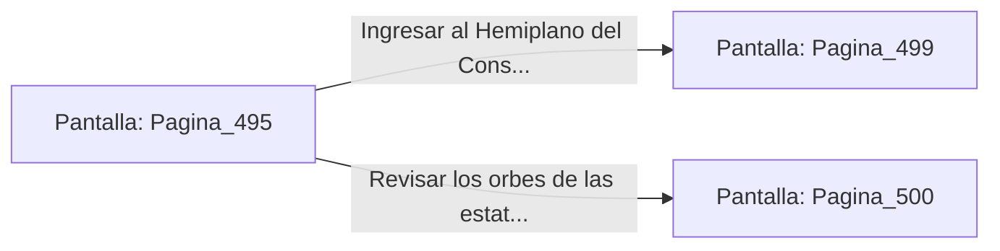

# 📺 Nodo Pantalla: `Pagina_495`

[[Index|⬅️ Índice]] | Fichero Origen: [[sample_eligejuego-code_capitulo_26_mpl|📄 sample/eligejuego-code/capitulo_26.mpl]]

**Narrativa y Encabezado:**
> PÁGINA 495: DESTRUCCIÓN DE LOS BASTONES ASTRALES
> 
> Alineas la mira del Rifle Cronal y descargas dos ráfagas de aceleración concisa. Los proyectiles impactan de lleno en los orbes energéticos de los bastones, provocando una explosión de chispas cian que desarticula la forma física de los dos Custodios Astrales.
> 
> Con la vía despejada, alcanzas el altar de la nave donde se halla un nicho blindado con dos Células de Éter Sobrecargadas y la Tarjeta de Acceso al Hemiplano del Consejo.
> 
> Sincronizas los componentes con tu arnés táctico antes de dirigirte a la entrada del Hemiplano del Consejo.

## 📋 Desglose de Instrucciones de Opciones
### `OPCION "Ingresar al Hemiplano del Consejo con la tarjeta de acceso" CON_ACCION TRANSICIONAR_A Pagina_499`
* **Instrucción:** `OPCION` *(Manual: Mapea una entrada o botón interactivo de usuario. Vincular una acción como la invocación de una función C1, un método C2 o una transición C3.)*
* **Efecto de Control:** Dispara `TRANSICIONAR_A` hacia [[Pantalla_Pagina_499|📺 Pagina_499]]
### `OPCION "Revisar los orbes de las estatuas contiguas" CON_ACCION TRANSICIONAR_A Pagina_500`
* **Instrucción:** `OPCION` *(Manual: Mapea una entrada o botón interactivo de usuario. Vincular una acción como la invocación de una función C1, un método C2 o una transición C3.)*
* **Efecto de Control:** Dispara `TRANSICIONAR_A` hacia [[Pantalla_Pagina_500|📺 Pagina_500]]

## 📊 Diagrama de Flujo e Interacción (Mermaid)

