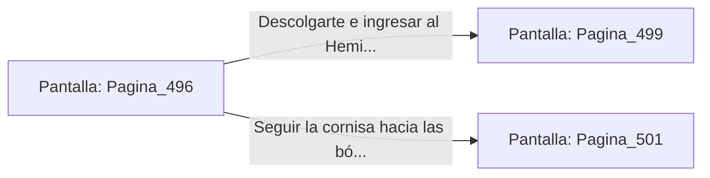

# 📺 Nodo Pantalla: `Pagina_496`

[[Index|⬅️ Índice]] | Fichero Origen: [[sample_eligejuego-code_capitulo_26_mpl|📄 sample/eligejuego-code/capitulo_26.mpl]]

**Narrativa y Encabezado:**
> PÁGINA 496: EVASIÓN POR LA CORNISA LATERAL
> 
> Disparas el gancho de agarre y te elevas hacia la cornisa de basalto del muro, dejando abajo a los Custodios Astrales. Avanzas por la estructura hasta superar la zona de patrulla.
> 
> Te descuelgas limpiamente al otro lado de la galería frente al portón del Hemiplano.

## 📋 Desglose de Instrucciones de Opciones
### `OPCION "Descolgarte e ingresar al Hemiplano del Consejo" CON_ACCION TRANSICIONAR_A Pagina_499`
* **Instrucción:** `OPCION` *(Manual: Mapea una entrada o botón interactivo de usuario. Vincular una acción como la invocación de una función C1, un método C2 o una transición C3.)*
* **Efecto de Control:** Dispara `TRANSICIONAR_A` hacia [[Pantalla_Pagina_499|📺 Pagina_499]]
### `OPCION "Seguir la cornisa hacia las bóvedas de meditación" CON_ACCION TRANSICIONAR_A Pagina_501`
* **Instrucción:** `OPCION` *(Manual: Mapea una entrada o botón interactivo de usuario. Vincular una acción como la invocación de una función C1, un método C2 o una transición C3.)*
* **Efecto de Control:** Dispara `TRANSICIONAR_A` hacia [[Pantalla_Pagina_501|📺 Pagina_501]]

## 📊 Diagrama de Flujo e Interacción (Mermaid)

