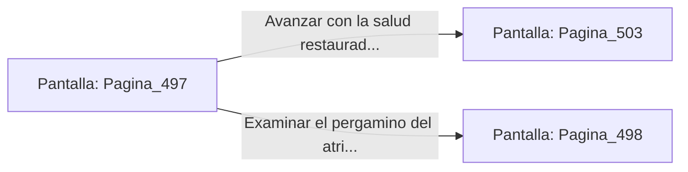

# 📺 Nodo Pantalla: `Pagina_497`

[[Index|⬅️ Índice]] | Fichero Origen: [[sample_eligejuego-code_capitulo_26_mpl|📄 sample/eligejuego-code/capitulo_26.mpl]]

**Narrativa y Encabezado:**
> PÁGINA 497: EL COFRE DE LOS TÓNICOS ASTRALES
> 
> Fuerzas la cerradura del cofre de bronce usando la estaca rúnica de tu Brazal. La tapa se abre revelando dos viales de Suero Reconstituyente y una bomba de pulso electromagnético concentrado.
> 
> Inyectas una de las dosis de suero en tu armadura, sintiendo cómo una agradable calidez regenerativa repara las grietas físicas y restablece la vitalidad máxima de tu equipo.
> 
> Guardas el segundo vial en tu cinturón y reanudas la marcha hacia la Cámara del Consejo.

## 📋 Desglose de Instrucciones de Opciones
### `OPCION "Avanzar con la salud restaurada hacia la Cámara del Consejo" CON_ACCION TRANSICIONAR_A Pagina_503`
* **Instrucción:** `OPCION` *(Manual: Mapea una entrada o botón interactivo de usuario. Vincular una acción como la invocación de una función C1, un método C2 o una transición C3.)*
* **Efecto de Control:** Dispara `TRANSICIONAR_A` hacia [[Pantalla_Pagina_503|📺 Pagina_503]]
### `OPCION "Examinar el pergamino del atril antes de continuar" CON_ACCION TRANSICIONAR_A Pagina_498`
* **Instrucción:** `OPCION` *(Manual: Mapea una entrada o botón interactivo de usuario. Vincular una acción como la invocación de una función C1, un método C2 o una transición C3.)*
* **Efecto de Control:** Dispara `TRANSICIONAR_A` hacia [[Pantalla_Pagina_498|📺 Pagina_498]]

## 📊 Diagrama de Flujo e Interacción (Mermaid)

