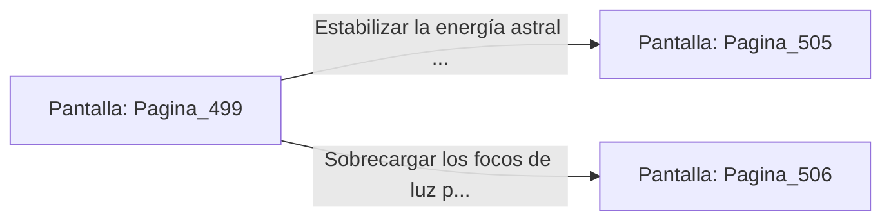

# 📺 Nodo Pantalla: `Pagina_499`

[[Index|⬅️ Índice]] | Fichero Origen: [[sample_eligejuego-code_capitulo_26_mpl|📄 sample/eligejuego-code/capitulo_26.mpl]]

**Narrativa y Encabezado:**
> PÁGINA 499: EL HEMIPLANO DEL CONSEJO
> 
> Deslizas la tarjeta de acceso por la ranura rúnica e ingresas al majestuoso Hemiplano del Consejo. Asientos de piedra dispuestos en semicírculo rodean un altar tridimensional donde flota el Sello del Anillo Interior del Núcleo.
> 
> En la consola principal brilla la Tarjeta de Nivel Nueve y un conmutador de purga que permite estabilizar la energía astral o sobrecargar los focos de luz.
> 
> Sincronizas la Tarjeta de Nivel Nueve en tu Brazal de Convergencia antes de operar los mandos de la consola.

## 📋 Desglose de Instrucciones de Opciones
### `OPCION "Estabilizar la energía astral en la consola central" CON_ACCION TRANSICIONAR_A Pagina_505`
* **Instrucción:** `OPCION` *(Manual: Mapea una entrada o botón interactivo de usuario. Vincular una acción como la invocación de una función C1, un método C2 o una transición C3.)*
* **Efecto de Control:** Dispara `TRANSICIONAR_A` hacia [[Pantalla_Pagina_505|📺 Pagina_505]]
### `OPCION "Sobrecargar los focos de luz para inutilizar las defensas" CON_ACCION TRANSICIONAR_A Pagina_506`
* **Instrucción:** `OPCION` *(Manual: Mapea una entrada o botón interactivo de usuario. Vincular una acción como la invocación de una función C1, un método C2 o una transición C3.)*
* **Efecto de Control:** Dispara `TRANSICIONAR_A` hacia [[Pantalla_Pagina_506|📺 Pagina_506]]

## 📊 Diagrama de Flujo e Interacción (Mermaid)

