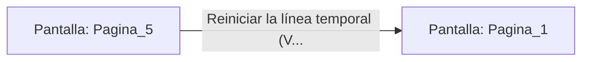

# 📺 Nodo Pantalla: `Pagina_5`

[[Index|⬅️ Índice]] | Fichero Origen: [[sample_eligejuego-code_capitulo_01_mpl|📄 sample/eligejuego-code/capitulo_01.mpl]]

**Narrativa y Encabezado:**
> PÁGINA 5: EL PUENTE ROTO
> 
> Pones un pie sobre las maderas podridas del puente de cordel. Con apenas tres pasos dados, las sogas primarias ceden bajo la tensión de los siglos, desgarrándose con un chasquido seco que resuena en toda la sima.
> 
> Caes al vacío interminable mientras la niebla del Vaciadero devora tus gritos. Tu aventura termina aquí, sofocada por la oscuridad del abismo.

## 📋 Desglose de Instrucciones de Opciones
### `OPCION "Reiniciar la línea temporal (Volver al Inicio)" CON_ACCION TRANSICIONAR_A Pagina_1`
* **Instrucción:** `OPCION` *(Manual: Mapea una entrada o botón interactivo de usuario. Vincular una acción como la invocación de una función C1, un método C2 o una transición C3.)*
* **Efecto de Control:** Dispara `TRANSICIONAR_A` hacia [[Pantalla_Pagina_1|📺 Pagina_1]]

## 📊 Diagrama de Flujo e Interacción (Mermaid)

