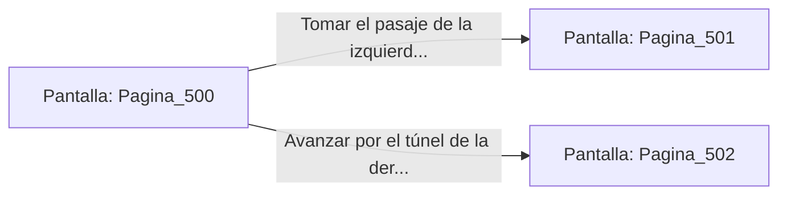

# 📺 Nodo Pantalla: `Pagina_500`

[[Index|⬅️ Índice]] | Fichero Origen: [[sample_eligejuego-code_capitulo_09_camara_talisman_mpl|📄 sample/eligejuego-code/capitulo_09_camara_talisman.mpl]]

**Narrativa y Encabezado:**
> Página 500: La Cámara del Talismán
> 
> La magia en esta sala es tan densa que cuesta respirar. En el centro brilla la reliquia sagrada. Te encuentras ante una encrucijada en la penumbra de la mazmorra. Debes tomar una decisión.

## 📋 Desglose de Instrucciones de Opciones
### `OPCION "Tomar el pasaje de la izquierda (Página 501)" CON_ACCION TRANSICIONAR_A Pagina_501`
* **Instrucción:** `OPCION` *(Manual: Mapea una entrada o botón interactivo de usuario. Vincular una acción como la invocación de una función C1, un método C2 o una transición C3.)*
* **Efecto de Control:** Dispara `TRANSICIONAR_A` hacia [[Pantalla_Pagina_501|📺 Pagina_501]]
### `OPCION "Avanzar por el túnel de la derecha (Página 502)" CON_ACCION TRANSICIONAR_A Pagina_502`
* **Instrucción:** `OPCION` *(Manual: Mapea una entrada o botón interactivo de usuario. Vincular una acción como la invocación de una función C1, un método C2 o una transición C3.)*
* **Efecto de Control:** Dispara `TRANSICIONAR_A` hacia [[Pantalla_Pagina_502|📺 Pagina_502]]

## 📊 Diagrama de Flujo e Interacción (Mermaid)

