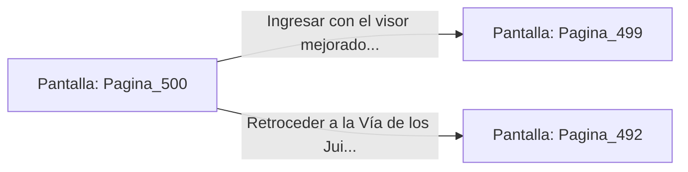

# 📺 Nodo Pantalla: `Pagina_500`

[[Index|⬅️ Índice]] | Fichero Origen: [[sample_eligejuego-code_capitulo_26_mpl|📄 sample/eligejuego-code/capitulo_26.mpl]]

**Narrativa y Encabezado:**
> PÁGINA 500: REVISIÓN DE LOS ORBES ASTRALES
> 
> Examinas los orbes de las estatuas contiguas y recuperas un visor de enfoque térmico que adosas al casco de tu armadura.
> 
> Con la mejora integrada, ingresas al Hemiplano del Consejo.

## 📋 Desglose de Instrucciones de Opciones
### `OPCION "Ingresar con el visor mejorado al Hemiplano del Consejo" CON_ACCION TRANSICIONAR_A Pagina_499`
* **Instrucción:** `OPCION` *(Manual: Mapea una entrada o botón interactivo de usuario. Vincular una acción como la invocación de una función C1, un método C2 o una transición C3.)*
* **Efecto de Control:** Dispara `TRANSICIONAR_A` hacia [[Pantalla_Pagina_499|📺 Pagina_499]]
### `OPCION "Retroceder a la Vía de los Juicios Ancestrales" CON_ACCION TRANSICIONAR_A Pagina_492`
* **Instrucción:** `OPCION` *(Manual: Mapea una entrada o botón interactivo de usuario. Vincular una acción como la invocación de una función C1, un método C2 o una transición C3.)*
* **Efecto de Control:** Dispara `TRANSICIONAR_A` hacia [[Pantalla_Pagina_492|📺 Pagina_492]]

## 📊 Diagrama de Flujo e Interacción (Mermaid)

