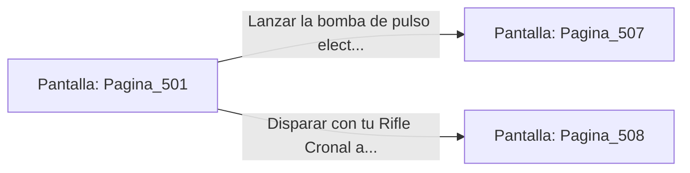

# 📺 Nodo Pantalla: `Pagina_501`

[[Index|⬅️ Índice]] | Fichero Origen: [[sample_eligejuego-code_capitulo_26_mpl|📄 sample/eligejuego-code/capitulo_26.mpl]]

**Narrativa y Encabezado:**
> PÁGINA 501: LAS BÓVEDAS DE MEDITACIÓN
> 
> Te descuelgas a las Bóvedas de Meditación del Consejo. Esferas de cuarzo transparente albergan la memoria acumulada de los sabios de Aethelgard, emitiendo un zumbido armónico constante.
> 
> Un autómata guardián de titanio custodia la peana central esgrimiendo una alabarda de energía. La unidad detecta tu firma de energía e inicia la secuencia de ataque.
> 
> Puedes usar tu bomba de pulso electromagnético para anular sus escudos o disparar con tu Rifle Cronal al conector de su pecho.

## 📋 Desglose de Instrucciones de Opciones
### `OPCION "Lanzar la bomba de pulso electromagnético contra el autómata de titanio" CON_ACCION TRANSICIONAR_A Pagina_507`
* **Instrucción:** `OPCION` *(Manual: Mapea una entrada o botón interactivo de usuario. Vincular una acción como la invocación de una función C1, un método C2 o una transición C3.)*
* **Efecto de Control:** Dispara `TRANSICIONAR_A` hacia [[Pantalla_Pagina_507|📺 Pagina_507]]
### `OPCION "Disparar con tu Rifle Cronal al conector de su pecho" CON_ACCION TRANSICIONAR_A Pagina_508`
* **Instrucción:** `OPCION` *(Manual: Mapea una entrada o botón interactivo de usuario. Vincular una acción como la invocación de una función C1, un método C2 o una transición C3.)*
* **Efecto de Control:** Dispara `TRANSICIONAR_A` hacia [[Pantalla_Pagina_508|📺 Pagina_508]]

## 📊 Diagrama de Flujo e Interacción (Mermaid)

