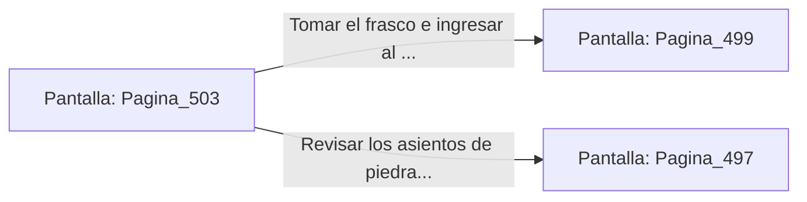

# 📺 Nodo Pantalla: `Pagina_503`

[[Index|⬅️ Índice]] | Fichero Origen: [[sample_eligejuego-code_capitulo_26_mpl|📄 sample/eligejuego-code/capitulo_26.mpl]]

**Narrativa y Encabezado:**
> PÁGINA 503: LA CÁMARA DEL CONSEJO ANCESTRAL
> 
> Ingresas a la Cámara del Consejo Ancestral. En el centro de la nave, una columna de luz dorada conecta el suelo con el techo abovedado, canalizando energía limpia hacia los niveles superiores.
> 
> En la peana central reposa un frasco de Éter Puro Concentrado y una clave de acceso al Anillo Interior del Núcleo.
> 
> Te apoderas del frasco y sincronizas la clave en tu Brazal antes de avanzar al Hemiplano del Consejo.

## 📋 Desglose de Instrucciones de Opciones
### `OPCION "Tomar el frasco e ingresar al Hemiplano del Consejo" CON_ACCION TRANSICIONAR_A Pagina_499`
* **Instrucción:** `OPCION` *(Manual: Mapea una entrada o botón interactivo de usuario. Vincular una acción como la invocación de una función C1, un método C2 o una transición C3.)*
* **Efecto de Control:** Dispara `TRANSICIONAR_A` hacia [[Pantalla_Pagina_499|📺 Pagina_499]]
### `OPCION "Revisar los asientos de piedra del consejo" CON_ACCION TRANSICIONAR_A Pagina_497`
* **Instrucción:** `OPCION` *(Manual: Mapea una entrada o botón interactivo de usuario. Vincular una acción como la invocación de una función C1, un método C2 o una transición C3.)*
* **Efecto de Control:** Dispara `TRANSICIONAR_A` hacia [[Pantalla_Pagina_497|📺 Pagina_497]]

## 📊 Diagrama de Flujo e Interacción (Mermaid)

