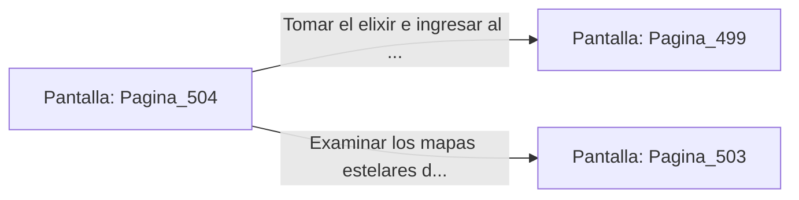

# 📺 Nodo Pantalla: `Pagina_504`

[[Index|⬅️ Índice]] | Fichero Origen: [[sample_eligejuego-code_capitulo_26_mpl|📄 sample/eligejuego-code/capitulo_26.mpl]]

**Narrativa y Encabezado:**
> PÁGINA 504: EL CORREDOR DE LOS ASTRÓNOMOS DEL CONSEJO
> 
> Avanzas por el corredor privado de los antiguos astrónomos del consejo. Las paredes están decoradas con mapas estelares y esferas armilares de bronce.
> 
> Al final del pasillo hallas una hornacina con un vial de elixir reconstituyente.

## 📋 Desglose de Instrucciones de Opciones
### `OPCION "Tomar el elixir e ingresar al Hemiplano del Consejo" CON_ACCION TRANSICIONAR_A Pagina_499`
* **Instrucción:** `OPCION` *(Manual: Mapea una entrada o botón interactivo de usuario. Vincular una acción como la invocación de una función C1, un método C2 o una transición C3.)*
* **Efecto de Control:** Dispara `TRANSICIONAR_A` hacia [[Pantalla_Pagina_499|📺 Pagina_499]]
### `OPCION "Examinar los mapas estelares del muro" CON_ACCION TRANSICIONAR_A Pagina_503`
* **Instrucción:** `OPCION` *(Manual: Mapea una entrada o botón interactivo de usuario. Vincular una acción como la invocación de una función C1, un método C2 o una transición C3.)*
* **Efecto de Control:** Dispara `TRANSICIONAR_A` hacia [[Pantalla_Pagina_503|📺 Pagina_503]]

## 📊 Diagrama de Flujo e Interacción (Mermaid)

