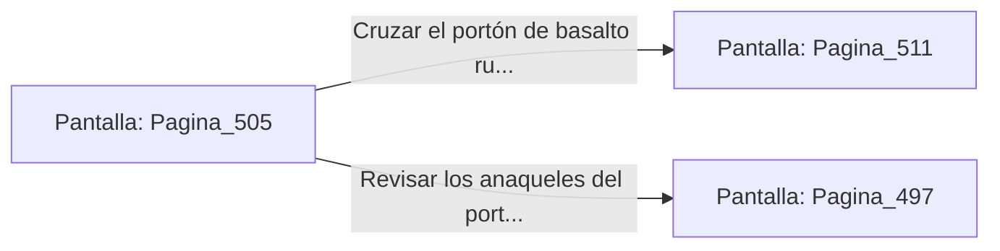

# 📺 Nodo Pantalla: `Pagina_505`

[[Index|⬅️ Índice]] | Fichero Origen: [[sample_eligejuego-code_capitulo_26_mpl|📄 sample/eligejuego-code/capitulo_26.mpl]]

**Narrativa y Encabezado:**
> PÁGINA 505: EL PASO HACIA EL CAPÍTULO 27
> 
> Con la Tarjeta de Nivel Nueve autenticada y la energía astral estabilizada en parámetros seguros, el portón acorazado de basalto del extremo norte se abre suavemente en dos mitades.
> 
> Ante ti se despliega la calzada iluminada por cristales dorados que conduce hacia las Cámaras del Capítulo 27, donde se halla el Anillo Interior del Núcleo de Éter.
> 
> Verificas el estado de tus armas y tu equipo médico antes de cruzar el umbral con determinación.

## 📋 Desglose de Instrucciones de Opciones
### `OPCION "Cruzar el portón de basalto rumbo al Capítulo 27" CON_ACCION TRANSICIONAR_A Pagina_511`
* **Instrucción:** `OPCION` *(Manual: Mapea una entrada o botón interactivo de usuario. Vincular una acción como la invocación de una función C1, un método C2 o una transición C3.)*
* **Efecto de Control:** Dispara `TRANSICIONAR_A` hacia [[Pantalla_Pagina_511|📺 Pagina_511]]
### `OPCION "Revisar los anaqueles del portón en busca de suministros" CON_ACCION TRANSICIONAR_A Pagina_497`
* **Instrucción:** `OPCION` *(Manual: Mapea una entrada o botón interactivo de usuario. Vincular una acción como la invocación de una función C1, un método C2 o una transición C3.)*
* **Efecto de Control:** Dispara `TRANSICIONAR_A` hacia [[Pantalla_Pagina_497|📺 Pagina_497]]

## 📊 Diagrama de Flujo e Interacción (Mermaid)

