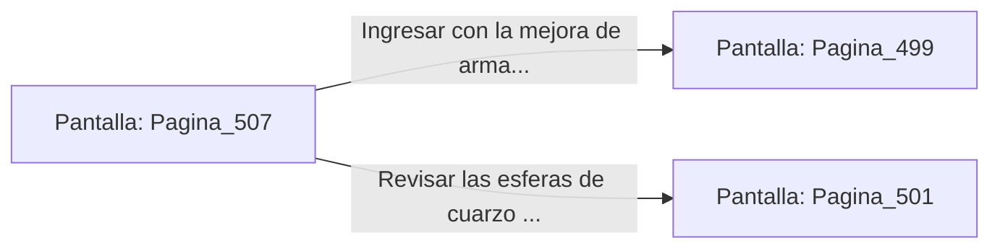

# 📺 Nodo Pantalla: `Pagina_507`

[[Index|⬅️ Índice]] | Fichero Origen: [[sample_eligejuego-code_capitulo_26_mpl|📄 sample/eligejuego-code/capitulo_26.mpl]]

**Narrativa y Encabezado:**
> PÁGINA 507: ANULACIÓN DEL AUTÓMATA DE TITANIO
> 
> Lanzas la bomba de pulso electromagnético a los pies del autómata de titanio. La onda expansiva desactiva su escudo de energía y sobrecarga los circuitos de su torso.
> 
> La unidad colapsa inerte sobre el piso de basalto. Al examinar sus restos, recuperas un Cristal de Enfoque Óptico y dos células de energía de alto flujo.
> 
> Adosas el cristal a tu arma de fase antes de cruzar la puerta de salida hacia el Hemiplano del Consejo.

## 📋 Desglose de Instrucciones de Opciones
### `OPCION "Ingresar con la mejora de arma al Hemiplano del Consejo" CON_ACCION TRANSICIONAR_A Pagina_499`
* **Instrucción:** `OPCION` *(Manual: Mapea una entrada o botón interactivo de usuario. Vincular una acción como la invocación de una función C1, un método C2 o una transición C3.)*
* **Efecto de Control:** Dispara `TRANSICIONAR_A` hacia [[Pantalla_Pagina_499|📺 Pagina_499]]
### `OPCION "Revisar las esferas de cuarzo de la sala" CON_ACCION TRANSICIONAR_A Pagina_501`
* **Instrucción:** `OPCION` *(Manual: Mapea una entrada o botón interactivo de usuario. Vincular una acción como la invocación de una función C1, un método C2 o una transición C3.)*
* **Efecto de Control:** Dispara `TRANSICIONAR_A` hacia [[Pantalla_Pagina_501|📺 Pagina_501]]

## 📊 Diagrama de Flujo e Interacción (Mermaid)

