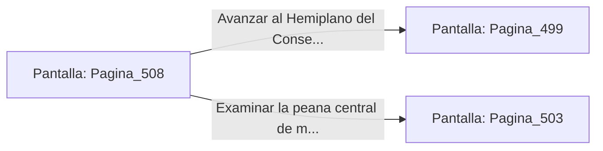

# 📺 Nodo Pantalla: `Pagina_508`

[[Index|⬅️ Índice]] | Fichero Origen: [[sample_eligejuego-code_capitulo_26_mpl|📄 sample/eligejuego-code/capitulo_26.mpl]]

**Narrativa y Encabezado:**
> PÁGINA 508: IMPACTO EN EL CONECTOR PECTORAL
> 
> Descargas una ráfaga con el Rifle Cronal directamente sobre el conector pectoral del autómata. La sobrecarga destruye el motor de energía, haciéndolo desplomarse sobre las losas.
> 
> Con la nave libre, recoges las células de energía y te encaminas a la salida.

## 📋 Desglose de Instrucciones de Opciones
### `OPCION "Avanzar al Hemiplano del Consejo" CON_ACCION TRANSICIONAR_A Pagina_499`
* **Instrucción:** `OPCION` *(Manual: Mapea una entrada o botón interactivo de usuario. Vincular una acción como la invocación de una función C1, un método C2 o una transición C3.)*
* **Efecto de Control:** Dispara `TRANSICIONAR_A` hacia [[Pantalla_Pagina_499|📺 Pagina_499]]
### `OPCION "Examinar la peana central de meditación" CON_ACCION TRANSICIONAR_A Pagina_503`
* **Instrucción:** `OPCION` *(Manual: Mapea una entrada o botón interactivo de usuario. Vincular una acción como la invocación de una función C1, un método C2 o una transición C3.)*
* **Efecto de Control:** Dispara `TRANSICIONAR_A` hacia [[Pantalla_Pagina_503|📺 Pagina_503]]

## 📊 Diagrama de Flujo e Interacción (Mermaid)

