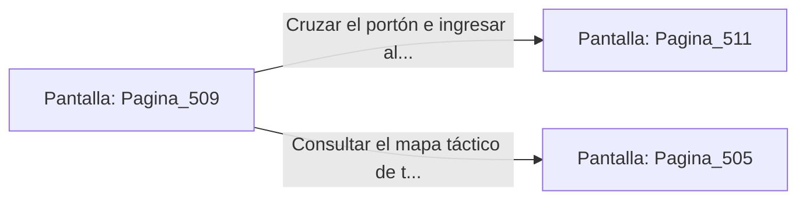

# 📺 Nodo Pantalla: `Pagina_509`

[[Index|⬅️ Índice]] | Fichero Origen: [[sample_eligejuego-code_capitulo_26_mpl|📄 sample/eligejuego-code/capitulo_26.mpl]]

**Narrativa y Encabezado:**
> PÁGINA 509: EL TRIUNFO EN EL SANTUARIO DEL CONSEJO
> 
> Atraviesas las naves purificadas de los Santuarios del Consejo de Sabios llevando la Tarjeta de Nivel Nueve y tus reservas curativas reabastecidas. La luz cian de las constelaciones brilla con un tono dorado pacífico.
> 
> Tu Brazal de Convergencia confirma que las Cámaras 491 a 510 han sido estabilizadas con éxito dentro de la red del complejo.
> 
> Te detienes un instante frente al portón del Capítulo 27 con la firmeza del guerrero a un paso de la victoria final.

## 📋 Desglose de Instrucciones de Opciones
### `OPCION "Cruzar el portón e ingresar al Capítulo 27" CON_ACCION TRANSICIONAR_A Pagina_511`
* **Instrucción:** `OPCION` *(Manual: Mapea una entrada o botón interactivo de usuario. Vincular una acción como la invocación de una función C1, un método C2 o una transición C3.)*
* **Efecto de Control:** Dispara `TRANSICIONAR_A` hacia [[Pantalla_Pagina_511|📺 Pagina_511]]
### `OPCION "Consultar el mapa táctico de tu Brazal" CON_ACCION TRANSICIONAR_A Pagina_505`
* **Instrucción:** `OPCION` *(Manual: Mapea una entrada o botón interactivo de usuario. Vincular una acción como la invocación de una función C1, un método C2 o una transición C3.)*
* **Efecto de Control:** Dispara `TRANSICIONAR_A` hacia [[Pantalla_Pagina_505|📺 Pagina_505]]

## 📊 Diagrama de Flujo e Interacción (Mermaid)

