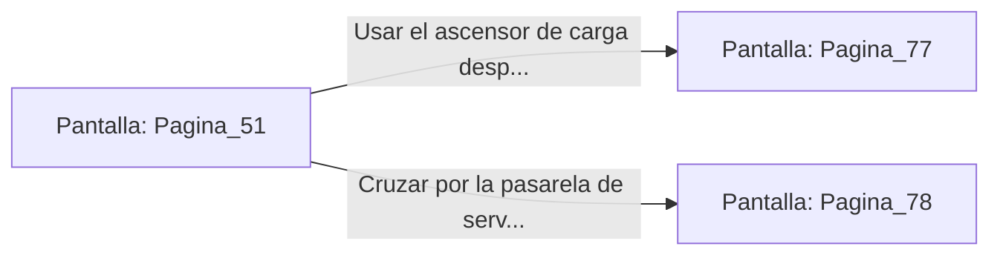

# 📺 Nodo Pantalla: `Pagina_51`

[[Index|⬅️ Índice]] | Fichero Origen: [[sample_eligejuego-code_capitulo_04_mpl|📄 sample/eligejuego-code/capitulo_04.mpl]]

**Narrativa y Encabezado:**
> PÁGINA 51: SABOTAJE EN LA TORRE
> 
> Abres el panel posterior de la antena repetidora e introduces una sobrecarga rúnica con tu Brazal de Convergencia. Los circuitos de éter echan chispas doradas mientras las frecuencias de emisión se distorsionan, sumiendo en el silencio absoluto a todas las radios de la guarnición de Malakor.
> 
> Sin comunicaciones, las unidades de patrulla en el patio inferior comienzan a replegarse en desorden, buscando confirmar las órdenes cara a cara. El camino hacia el ascensor de bajada ha quedado prácticamente despejado de vigilancia activa.
> 
> Puedes aprovechar el momento para usar el ascensor de carga hacia el patio o cruzar por la pasarela de servicio que lleva hacia las calderas centrales.

## 📋 Desglose de Instrucciones de Opciones
### `OPCION "Usar el ascensor de carga desprotegido hacia el Patio Central" CON_ACCION TRANSICIONAR_A Pagina_77`
* **Instrucción:** `OPCION` *(Manual: Mapea una entrada o botón interactivo de usuario. Vincular una acción como la invocación de una función C1, un método C2 o una transición C3.)*
* **Efecto de Control:** Dispara `TRANSICIONAR_A` hacia [[Pantalla_Pagina_77|📺 Pagina_77]]
### `OPCION "Cruzar por la pasarela de servicio hacia las Calderas Centrales" CON_ACCION TRANSICIONAR_A Pagina_78`
* **Instrucción:** `OPCION` *(Manual: Mapea una entrada o botón interactivo de usuario. Vincular una acción como la invocación de una función C1, un método C2 o una transición C3.)*
* **Efecto de Control:** Dispara `TRANSICIONAR_A` hacia [[Pantalla_Pagina_78|📺 Pagina_78]]

## 📊 Diagrama de Flujo e Interacción (Mermaid)

