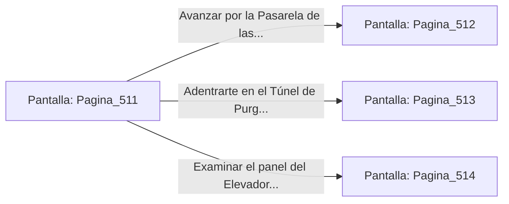

# 📺 Nodo Pantalla: `Pagina_511`

[[Index|⬅️ Índice]] | Fichero Origen: [[sample_eligejuego-code_capitulo_27_mpl|📄 sample/eligejuego-code/capitulo_27.mpl]]

**Narrativa y Encabezado:**
> PÁGINA 511: EL UMBRAL DEL ANILLO INTERIOR
> 
> Atraviesas el portón de basalto e ingresas a la sobrecogedora calzada circular del Anillo Interior del Núcleo. El suelo de mármol translúcido flota directamente sobre el abismo primordial de Aethelgard, mientras la inmensa columna de fuego esmeralda del Núcleo de Éter ruge en el centro de la estructura, proyectando destellos dorados sobre los arcos de contención.
> 
> Tu Brazal de Convergencia registra que las Cámaras 511 a 530 forman la última barrera física antes del núcleo maestro. Guardianes de Fase Primordiales, armados con albardas de luz refractaria y escudos de inducción cuántica, patrullan el corredor periférico en perfecta formación.
> 
> Frente a ti se abren tres vías para penetrar en el anillo: la Pasarela de las Cúpulas de Cristal, el Túnel de Purga de Flujo y el Elevador Magnético del Núcleo.

## 📋 Desglose de Instrucciones de Opciones
### `OPCION "Avanzar por la Pasarela de las Cúpulas de Cristal" CON_ACCION TRANSICIONAR_A Pagina_512`
* **Instrucción:** `OPCION` *(Manual: Mapea una entrada o botón interactivo de usuario. Vincular una acción como la invocación de una función C1, un método C2 o una transición C3.)*
* **Efecto de Control:** Dispara `TRANSICIONAR_A` hacia [[Pantalla_Pagina_512|📺 Pagina_512]]
### `OPCION "Adentrarte en el Túnel de Purga de Flujo" CON_ACCION TRANSICIONAR_A Pagina_513`
* **Instrucción:** `OPCION` *(Manual: Mapea una entrada o botón interactivo de usuario. Vincular una acción como la invocación de una función C1, un método C2 o una transición C3.)*
* **Efecto de Control:** Dispara `TRANSICIONAR_A` hacia [[Pantalla_Pagina_513|📺 Pagina_513]]
### `OPCION "Examinar el panel del Elevador Magnético del Núcleo" CON_ACCION TRANSICIONAR_A Pagina_514`
* **Instrucción:** `OPCION` *(Manual: Mapea una entrada o botón interactivo de usuario. Vincular una acción como la invocación de una función C1, un método C2 o una transición C3.)*
* **Efecto de Control:** Dispara `TRANSICIONAR_A` hacia [[Pantalla_Pagina_514|📺 Pagina_514]]

## 📊 Diagrama de Flujo e Interacción (Mermaid)

